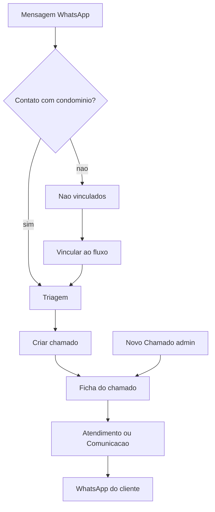

# Juricon — PRD operacional (manual visual as-is)

| Item | Valor |
|------|--------|
| Versão do sistema | 0.9.21 — Criar chamado (drawer e triagem) |
| Data deste PRD | 23/09/2026 |
| Escopo | Pasta `PORTAL JURIDICO CONDOMINIAL` |
| Natureza | **As-is** do código — o que a tela mostra e o que cada clique faz |
| Fonte de regras / APIs | [`DOCUMENTACAO-SISTEMA.md`](../DOCUMENTACAO-SISTEMA.md) |
| Catálogo de auditoria UX | [`WIREFRAME-TELAS.md`](WIREFRAME-TELAS.md) |

**Como usar este PRD:** cada seção é um “print” em texto da tela + tabela do que acontece em cada botão, chip, link e campo. Regras de negócio, endpoints e “onde olhar no código” ficam na documentação oficial — este arquivo não as substitui.

**Fora do escopo:** protótipo da pasta pai, questionário `perguntas/`, rota `/sindico`, rota `/ia`, cobrança, hash, ICP, portal do síndico.

---

## Índice

1. [O produto em uma página](#1-o-produto-em-uma-página)
2. [Fluxos ponta a ponta](#2-fluxos-ponta-a-ponta)
3. [Chrome — AppShell](#3-chrome--appshell)
4. [Login `/login`](#4-login-login)
5. [Visão `/`](#5-visão-)
6. [Atendimento `/atendimento`](#6-atendimento-atendimento)
7. [Triagem `/triagem`](#7-triagem-triagem)
8. [Triagem deep link `/triagem/[id]`](#8-triagem-deep-link-triagemid)
9. [Não vinculados `/nao-vinculados`](#9-não-vinculados-nao-vinculados)
10. [Chamados `/chamados`](#10-chamados-chamados)
11. [Ficha do chamado `/chamados/[id]`](#11-ficha-do-chamado-chamadosid)
12. [Documentos `/documentos`](#12-documentos-documentos)
12b. [Documentos do sistema `/documentos-sistema`](#12b-documentos-do-sistema-documentos-sistema)
13. [Condomínios `/condominios`](#13-condomínios-condominios)
14. [Ficha do condomínio `/condominios/[id]`](#14-ficha-do-condomínio-condominiosid)
15. [Equipe `/equipe`](#15-equipe-equipe)
16. [Conexões `/conexoes`](#16-conexões-conexoes)
16b. [Mensagens automáticas `/mensagens-automaticas`](#16b-mensagens-automáticas-mensagens-automaticas)
17. [Prazos `/prazos`](#17-prazos-prazos)
18. [Overlays (prints)](#18-overlays-prints)
19. [Matriz de papéis](#19-matriz-de-papéis)
20. [Guia rápido do dia a dia](#20-guia-rápido-do-dia-a-dia)

---

## 1. O produto em uma página

**Juricon** é o escritório jurídico condominial interno: um WhatsApp do escritório, cadastro de condomínios/contatos, fila de números novos, triagem, chamados, documentos e prazos internos.

| Papel | O que faz |
|-------|-----------|
| **admin** | Tudo: cadastros, triagem, não vinculados, equipe, conexões, criar chamado, aprovar rascunhos, reatribuir |
| **funcionario** | Inbox das conversas dos seus chamados, quadro/lista só dos atribuídos, documentos com chamado seu, prazos dos seus, Visão com KPIs sem link em Triagem/Não vinculados |

**Não existe** login do síndico neste sistema.

```text
┌─────────────────────────────────────────────────────────────────┐
│  WhatsApp do cliente                                            │
│       │                                                         │
│       ▼                                                         │
│  Contato já no condomínio? ──sim──► Triagem ──► Criar chamado   │
│       │ não                              │                      │
│       ▼                                  ▼                      │
│  Não vinculados ──Vincular──► Triagem   Ficha / Atendimento     │
│                                  │              │               │
│                                  └──────────────┘               │
│                                         │                       │
│                                         ▼                       │
│                              Resposta no WhatsApp               │
└─────────────────────────────────────────────────────────────────┘
```

---

## 2. Fluxos ponta a ponta

### 2.1 Mensagem inbound → chamado



**Passos numerados**

1. Cliente manda mensagem no WhatsApp conectado em **Conexões**.
2. Se o telefone (ou LID já cadastrado) pertence a um **contato com condomínio** → item em **Triagem** (sem criar chamado sozinho).
3. Se o número é avulso → conversa em **Não vinculados** (dá para responder; sem triagem e sem chamado).
4. Em Não vinculados, admin clica **Vincular ao fluxo** → confirma nome/telefone/condomínio → abre **Triagem** (não cria Ticket).
5. Na Triagem, admin preenche categoria/prioridade (responsável opcional) → **Criar chamado**.
6. Resposta ao cliente: **Atendimento** ou aba **Comunicação** da ficha.

### 2.2 Conectar WhatsApp (admin)

1. Menu **Conexões** → cartão **WhatsApp do escritório**.
2. **Conectar WhatsApp** → dialog com QR.
3. No celular: WhatsApp → Aparelhos conectados → Escanear.
4. Se a imagem envelhecer: espera ~20s ou **Atualizar QR**.
5. Status vira **CONECTADO**; pill no header e rodapé acompanham.

### 2.3 Cadastro que “abre o fluxo”

1. **Condomínios** → **Novo condomínio** (admin).
2. Na ficha ou no detalhe da lista → **Adicionar contato** (nome + telefone mascarado + cargo).
3. Próxima mensagem daquele número (ou LID já gravado no cadastro) cai em **Triagem**, não em Não vinculados.

### 2.4 Número só LID (WhatsApp não mostrou o telefone)

1. Aparece em **Não vinculados** com rótulo “Contato WhatsApp” / nome do pushName.
2. Dá para **Enviar** resposta usando o JID `@lid` (sem exigir telefone no composer).
3. Ao vincular: se Evolution liberar PN, telefone vem travado; senão campo obrigatório; com WA aberto use **Puxar do WhatsApp**.

### 2.5 Funcionário com “Não pode mandar WhatsApp”

1. Equipe marca o checkbox no usuário.
2. No composer, **Enviar** vira **Salvar rascunho** / **Enviar para aprovação**.
3. Admin vê **Aguardando aprovação** → **Aprovar e enviar**.

### 2.6 Documento e prazo

1. Documento do condomínio: **Documentos** → card do condomínio → **Novo documento**.
2. Documento do escritório: **Documentos do sistema** → categoria → **Novo documento** (admin; quatro perguntas).
3. Prazo: ficha do chamado → **Adicionar prazo** → aparece em **Prazos** e no header da ficha → **Concluir**.

---

## 3. Chrome — AppShell

**Quem vê:** qualquer autenticado. Itens com `*` só admin.

### 3.1 Desktop — admin (print)

```text
┌─ ~14rem ──────────┬──────────────────────────────────────────────────────────┐
│ [■] Juricon  v0.9.5│ [🔍 Buscar…]          [● WhatsApp Conectado] [+ Novo   │
│                   │                          Chamado]                  [AV] │
│ OPERAÇÃO          ├──────────────────────────────────────────────────────────┤
│  ▸ Visão          │                                                          │
│    Atendimento    │                     MAIN (conteúdo da rota)              │
│    Triagem    [3] │                                                          │
│    Não vinc.  [2] │                                                          │
│    Chamados   [5] │                                                          │
│    Prazos     [1] │                                                          │
│    Documentos     │                                                          │
│    Documentos do sistema │                                                   │
│    Condomínios    │                                                          │
│ ADMINISTRAÇÃO     │                                                          │
│    Equipe         │                                                          │
│    Documentos do sistema │                                                   │
│    Conexões       │                                                          │
│    Mensagens automáticas │                                                     │
│ ───────────────── │                                                          │
│ ● WA · Conectado  │                                                          │
│ [AV] Ana Admin    │                                                          │
│  ana@…      [⎋]   │                                                          │
└───────────────────┴──────────────────────────────────────────────────────────┘
  ▸ = rota ativa (barra navy + fundo suave)
  [n] = badge só se count > 0
  [⎋] = Sair
```

### 3.2 Desktop — funcionário (print)

```text
┌─ sidebar ─────────┬──────────────────────────────────────────────────────────┐
│ [■] Juricon  v0.9.5│ [🔍 Buscar…]          [● WhatsApp Conectado]      [FU] │
│                   │  (selo no chrome ainda é v0.9.5 no código)              │
│ OPERAÇÃO          ├──────────────────────────────────────────────────────────┤
│  Visão            │  (sem Novo Chamado; sem Triagem / Não vinc. / Equipe /   │
│  Atendimento      │   Conexões / Mensagens automáticas no menu)              │
│  Chamados         │                                                          │
│  Prazos           │                                                          │
│  Documentos       │                                                          │
│  Documentos do sistema │                                                     │
│  Condomínios      │                                                          │
│ ───────────────── │                                                          │
│ ● WA · Conectado  │  (texto, sem link)                                       │
│ [FU] Nome    [⎋]  │                                                          │
└───────────────────┴──────────────────────────────────────────────────────────┘
```

### 3.3 Mobile — admin / funcionário

```text
┌────────────────────────────────────┐
│ ☰          (busca some)     ● WA   │  header h-12
├────────────────────────────────────┤
│ conteúdo (1 painel por vez)        │
│ pb-16                              │
├────────────────────────────────────┤
│ Início  Inbox  Triagem  Mais       │  admin
│ Início  Inbox  Chamados Mais       │  funcionário
└────────────────────────────────────┘
```

### 3.4 Sheet **Mais** (mobile)

```text
┌──────────── Ir para ─────────────┐
│ Áreas que não cabem na barra.    │
│ Chamados                         │
│ Documentos                       │
│ Condomínios                      │
│ Prazos                           │
│ Triagem *        (se não no bar) │
│ Não vinculados *                 │
│ ── Administração * ───────────── │
│ Equipe *                         │
│ Conexões *                       │
│ Mensagens automáticas *          │
│ [ Sair ]                         │
└──────────────────────────────────┘
```

### Controles do chrome

| Rótulo | Quem | Ao clicar | Bloqueio / falha |
|--------|------|-----------|------------------|
| Juricon (logo) | todos | Vai para `/` | — |
| Visão | todos | `/` | — |
| Atendimento | todos | `/atendimento` | — |
| Triagem | admin | `/triagem` | Funcionário não vê no menu |
| Não vinculados | admin | `/nao-vinculados` | Idem |
| Chamados | todos | `/chamados` | — |
| Prazos | todos | `/prazos` | — |
| Documentos | todos | `/documentos` | — |
| Condomínios | todos | `/condominios` | — |
| Equipe | admin | `/equipe` | — |
| Conexões | admin | `/conexoes` | — |
| Mensagens automáticas | admin | `/mensagens-automaticas` | Funcionário não vê no menu |
| Buscar… | todos | `?q=` no módulo ativo (chamados, docs, triagem, não vinc., condomínios, equipe; senão atendimento) | — |
| WhatsApp {status} | admin → link | `/conexoes` | Funcionário só vê o pill |
| Novo Chamado | admin | `/chamados?novo=1` (abre drawer) | — |
| WA · {status} (rodapé) | admin → link | `/conexoes` | — |
| Sair | todos | `POST /api/auth/logout` → `/login` | — |
| Início / Inbox / Triagem\|Chamados / Mais | mobile | Navega / abre sheet | — |

**Estados:** badges somem quando count = 0. Item ativo: barra vertical brand + `aria-current`.

---

## 4. Login `/login`

**Quem:** público (sem shell).

### Print — normal

```text
┌────────────────────────────────────────┐
│         (fundo #f5f6f8 full screen)    │
│                                        │
│     ┌──────────────────────────┐       │
│     │      Juricon             │       │
│     │  Portal jurídico interno │       │
│     │                          │       │
│     │  E-mail  [____________]  │       │
│     │  Senha   [________] [👁] │       │
│     │  [      Entrar         ] │       │
│     │  Acesso restrito ao      │       │
│     │  escritório              │       │
│     └──────────────────────────┘       │
└────────────────────────────────────────┘
```

### Print — erro / sessão expirada

```text
│  (mesma tela)                          │
│  Sessão expirada. Entre novamente.     │  ← se ?expired=1
│  Credenciais inválidas                 │  ← 401
│  [Entrando…]                           │  ← loading no botão
```

### Controles

| Rótulo | Obrigatório | Ao usar | Bloqueio / falha |
|--------|-------------|---------|------------------|
| E-mail | Sim | Identificador | — |
| Senha | Sim | Segredo | — |
| Mostrar/Ocultar senha | — | Alterna `type` | — |
| Entrar | — | `POST /api/auth/login` → `/` | 401 genérico; 429 rate limit; rede |

**Não existe** “Esqueci a senha”.

---

## 5. Visão `/`

**Quem:** admin e funcionário (funcionário: cards Triagem e Não vinculados **sem** link de ação).

### Print — desktop

```text
┌─ sidebar ─┬──────────────────────────────────────────────────────────────────┐
│ …         │ Visão geral              [CONECTADO → WA]            [Atualizar] │
│           │ O que precisa de ação agora · terça-feira, 22 de setembro de 2026│
│           │ AGORA · FILA OPERACIONAL                                         │
│           │ ┌────────────┐ ┌────────────┐ ┌────────────┐ ┌────────────┐     │
│           │ │Não vinc. 👤│ │Triagem  ✓ │ │Não lidas ✉│ │Abertos 🎫  │     │
│           │ │     2      │ │     3     │ │     1     │ │     5      │     │
│           │ │Fora fluxo  │ │Classific. │ │Fila espera│ │Ativos      │     │
│           │ │ Vincular → │ │ Analisar→ │ │ Atender → │ │ Operar →   │     │
│           │ └────────────┘ └────────────┘ └────────────┘ └────────────┘     │
│           │ ┌─ ATENÇÃO · Prioridades ─┐ ┌─ MINHA OPERAÇÃO · Chamados → ───┐ │
│           │ │█ 2 Prazos vencidos     │ │ Protocolo Contato Status Prio  │ │
│           │ │  Resolver → /prazos    │ │ #2026-01  Maria  Aberto  Alta  │ │
│           │ │█ 1 Rascunhos…          │ │ #2026-02  João   Andam.  Méd.  │ │
│           │ │  Revisar →             │ │ Ver grade completa →            │ │
│           │ └────────────────────────┘ └─────────────────────────────────┘ │
│           │ ATIVIDADE RECENTE                                    Inbox →   │
│           │ [14:02] Maria — “Preciso da ata…”               Atendimento   │
└───────────┴──────────────────────────────────────────────────────────────────┘
```

Os quatro KPIs **sempre** aparecem, inclusive com **0**. Atenção só lista cartões com count > 0.

### Controles

| Rótulo | Quem | Ao clicar | Bloqueio |
|--------|------|-----------|----------|
| Atualizar | todos | Refaz `GET /api/dashboard` | — |
| CONECTADO → WA / pill | status | Informativo (não navega daqui) | — |
| Vincular (KPI) | admin | `/nao-vinculados` | Funcionário: sem link |
| Analisar (KPI) | admin | `/triagem` | Funcionário: sem link |
| Atender (KPI) | todos | `/atendimento` | — |
| Operar (KPI) | todos | `/chamados` | — |
| Cartão Atenção (Resolver, Ver prazos, Revisar, Atribuir, Seguir, Ver chamados) | todos | Vai à fila citada | Só se count > 0 |
| Linha Minha operação | todos | `/chamados/[id]` | — |
| Chamados → / Ver grade completa → | todos | `/chamados` | — |
| Atividade / Inbox → / Atendimento | todos | `/atendimento` | — |

### Estados

| Estado | O que aparece |
|--------|----------------|
| Loading | 4 skeletons nos KPIs |
| Empty tabela | “Nenhum chamado em aberto.” |
| Empty Atenção | “Nada exige atenção agora.” |
| Empty atividade | “Nenhuma conversa recente.” |
| Erro | “Não foi possível carregar a visão operacional.” + Tentar novamente |
| 403 | “Sem permissão para os indicadores operacionais.” |

---

## 6. Atendimento `/atendimento`

**Quem:** ambos (funcionário só conversas dos chamados atribuídos a ele).

### Print — desktop (3 painéis)

```text
┌─ sidebar ─┬─ Atendimento · Fila de entrada ─────────────────────────────────┐
│ …         │ [Todas] [Não lidas] [Triagem]                                   │
│           ├─ 240px ──────┬─ thread ──────────────────┬─ 220px contexto ────┤
│           │ Conversas    │ Maria Silva               │ Contexto do contato │
│           │ [Buscar…]    │ Residencial Aurora · WA   │ Contato             │
│           │              │                           │ Maria Silva         │
│           │ ● Maria      │ ── hoje ────────────────  │ Condomínio          │
│           │   Preciso…   │ [cliente] Preciso da ata  │ Residencial Aurora  │
│           │   14:02      │ [você] Segue em anexo     │ Chamado             │
│           │              │                           │ #2026-01 →          │
│           │ João (triag.)│ [Resposta] [Nota interna] │ Triagem             │
│           │              │ [Digite uma mensagem…]    │ Analisar →          │
│           │              │ [📎] [Áudio]    [Enviar]  │ [Mais informações]  │
└───────────┴──────────────┴───────────────────────────┴─────────────────────┘
```

### Print — mobile

```text
┌─ Atendimento ──────────────────────┐
│ [Todas][Não lidas][Triagem]        │
│ (lista | thread)  │  contexto 200  │
│ ← Conversas       │  (sempre)      │
└────────────────────────────────────┘
```

### Controles

| Rótulo | Quem | Ao clicar / usar | Bloqueio / falha |
|--------|------|------------------|------------------|
| Todas / Não lidas / Triagem | todos | Filtra lista | Só conversas **no fluxo** |
| Item conversa | todos | Seleciona thread; marca lida | 403 se alheia |
| ← Conversas | mobile | Volta à lista | — |
| Analisar | se triagem aberta | `/triagem/[id]` | — |
| #protocolo | se chamado | `/chamados/[id]` | — |
| Resposta | quem pode | Modo público | — |
| Nota interna | todos | Modo interno (nunca vai ao WA) | — |
| Áudio / Parar áudio / Cancelar | quem pode enviar | MediaRecorder | — |
| Enviar | quem pode + WA open | POST mensagem → WhatsApp na hora | WA fechado; sem permissão |
| Salvar rascunho / Enviar para aprovação | `apenasRascunho` | Grava draft público | Admin aprova depois |
| Salvar nota | modo interno | POST interna | — |
| Responder (bolha) | — | Cita mensagem | — |
| Reenviar / Aprovar e enviar | admin (failed/draft) | `POST /api/messages/:id/approve` | — |
| Aprovar e enviar (painel) | admin | Despacha rascunho | — |
| Carregar anteriores | — | Busca mensagens mais antigas (a thread abre na janela mais recente) | — |
| Mais informações | — | Expande bloco no painel contexto | — |

### Campos

| Campo | Obrigatório | O que grava |
|-------|-------------|-------------|
| Buscar conversas | Não | Filtro local |
| Texto da mensagem | Sim para enviar texto | Body público ou interno |
| Arquivo | Não | jpeg/png/pdf/áudio ≤ 8 MB |
| Áudio gravado | Não | webm/ogg |

### Estados

| Estado | Copy |
|--------|------|
| Empty | “Tudo limpo” / “Nenhuma conversa no fluxo.” |
| Thread vazia | “Selecione uma conversa” |
| WA off | “WhatsApp não está conectado.” |
| Só rascunho | “Seu perfil grava rascunho…” |
| Sem permissão envio | “Seu perfil não pode mandar WhatsApp.” |
| Erro | “Não foi possível carregar conversas.” |

**Live:** lista e bolhas fazem poll a cada ~3s com a aba em foco.

---

## 7. Triagem `/triagem`

**Quem:** **só admin** (funcionário: menu oculto + API 403).

### Print — desktop

```text
┌─ sidebar ─┬─ Triagem · 3 aguardando classificação · [Buscar…] ──────────────┐
│ …         ├─ lista ──────────┬─ análise ────────────────────────────────────┤
│           │ ● Maria Silva    │ Contato / mensagens (bolhas, SEM composer)   │
│           │   Preciso da ata │ ── Classificação ─────────────────────────── │
│           │   Aurora · 2h    │ Contato (só leitura): Maria Silva            │
│           │                  │ Condomínio (só leitura): Residencial Aurora  │
│           │ João Costa       │ Título *                                     │
│           │   …              │ Categoria ▼  Prioridade ▼  Responsável ▼     │
│           │                  │ [        Criar chamado        ]  (navy)      │
│           │                  │ [           Arquivar          ]  (ghost)     │
└───────────┴──────────────────┴──────────────────────────────────────────────┘
```

### Controles

| Rótulo | Ao clicar | Resultado | Bloqueio |
|--------|-----------|-----------|----------|
| Item da fila | Seleciona + `?id=` | Análise à direita | — |
| ← Solicitações | Mobile: volta lista | — | — |
| Título | Input | Prefill `Nome — Rótulo`; editar trava auto-update | Obrigatório (3–200) |
| Categoria / Prioridade | Select | Dados do promote | Obrigatórios |
| Responsável | Select | Opcional; “Sem responsável” | — |
| Criar chamado | PATCH promote | Toast “Chamado criado” → `/chamados/[id]` | Contato+condo já garantidos na fila; título válido |
| Arquivar | Abre ConfirmDialog | — | — |
| Confirm Arquivar | PATCH archive | “Solicitação arquivada” → `/triagem` | — |
| Cancelar (confirm) | Fecha dialog | — | — |

**Não há** Identificar / Vincular nesta tela (cadastro é em Condomínios ou Não vinculados).

### Estados

| Estado | Copy |
|--------|------|
| Empty lista | “Tudo limpo” / “Nada na triagem.” |
| Sem seleção | “Selecione uma solicitação” |
| Thread vazia | “Sem mensagens ainda” |
| 403 | Acesso restrito |
| Erro | “Falha ao carregar triagem.” |

---

## 8. Triagem deep link `/triagem/[id]`

**Quem:** admin.

### Print

```text
┌─ sidebar ─┬─────────────────────────────────────────────────────────────────┐
│ …         │ ← Triagem                                                       │
│           │ Analisar solicitação                                            │
│           ├─────────────────────────────────────────────────────────────────┤
│           │ (mesmo painel da §7: thread + Classificação + Criar/Arquivar)   │
└───────────┴─────────────────────────────────────────────────────────────────┘
```

| Rótulo | Ao clicar |
|--------|-----------|
| ← Triagem | Volta `/triagem` |

**Estados:** 404 “Solicitação não encontrada”; 403; “Falha ao carregar análise.”

---

## 9. Não vinculados `/nao-vinculados`

**Quem:** **só admin**.

### Print — desktop (3 painéis)

```text
┌─ sidebar ─┬─ Não vinculados · 2 fora do fluxo · msg → identidade → vincular ─┐
│ …         ├─ fila 280 ──────┬─ thread ───────────────────┬─ Identidade 240 ─┤
│           │ ┌─ card ────┐  │ Contato WhatsApp            │ Identidade       │
│           │ │█ [av] Nome│  │ Fora do fluxo · WA          │ 1. Mensagem recebida│
│           │ │  +55 …    │  │                             │ 2. Identificar quem é│
│           │ │  preview… │  │ [bolhas]                    │ 3. Vincular → triagem│
│           │ │  WhatsApp │  │                             │ Contato / Origem │
│           │ └───────────┘  │ [Resposta][Nota]            │ Condo: Não identificado│
│           │                │ […]          [Enviar]       │ Sem triagem/chamado… │
│           │                │                             │ [ Vincular ao fluxo ]│
└───────────┴────────────────┴─────────────────────────────┴──────────────────┘
```

Card da fila = mesmo de Atendimento (borda, raio, barra navy selecionada). Ordem: nome/idade → telefone → preview → WhatsApp/DEV. Sem `#protocolo`.
### Controles (além do ThreadPanel igual à Inbox)

| Rótulo | Ao clicar | Resultado | Bloqueio |
|--------|-----------|-----------|----------|
| Item fila | Seleciona | Thread à esquerda (identidade permanece à direita) | — |
| Vincular ao fluxo (painel) | Abre drawer | — | — |
| Puxar do WhatsApp | POST enrich-peer (deep) | Preenche telefone se Evolution liberar (chat → mensagem → agenda única) | Só se WA `open` e telefone ainda não travado |
| Conectar WhatsApp | Navega `/conexoes` | Abre Conexões para reconectar a sessão | Se telefone não travado e WA ≠ `open` |
| Vincular ao fluxo (submit drawer) | Abre ConfirmDialog | — | Nome + condo; telefone se sem PN |
| Confirmar vínculo | POST enroll | Cria/atualiza Contact + TriageItem → `/triagem/[id]` | **Não** cria Ticket |
| Cancelar | Fecha | — | — |

### Campos do drawer **Vincular ao fluxo**

| Campo | Obrigatório | Notas |
|-------|-------------|-------|
| Já cadastrado no condomínio | Não | “Novo cadastro” ou contato existente |
| Nome | Sim | — |
| Telefone | Condicional | Travado se veio do WhatsApp; senão obrigatório se LID |
| Papel | Não | Síndico / Administrador / Outro |
| Cargo (livre) | Não | — |
| E-mail | Não | — |
| Condomínio | Sim | Select |

### Estados

| Estado | Copy |
|--------|------|
| Empty | “Nenhum número fora do fluxo” |
| Loading | “Carregando fila…” |
| 403 / erro | Forbidden / “Não foi possível carregar números não vinculados.” |
| Enrich | “Puxando…” / toast se Evolution não liberar PN |

---

## 10. Chamados `/chamados`

**Quem:** ambos (criar e “Sem responsável”: admin).

### Print — Quadro (desktop)

```text
┌─ sidebar ─┬─ Chamados · 5 no quadro · 1 sem responsável · [Novo chamado]* ──┐
│ …         │ [Quadro] [Lista]   [Todos] [Meus] [Sem responsável]*            │
│           │ ▸ Filtros avançados · Categoria ▼ Prioridade ▼ Responsável ▼    │
│           ├──────────┬──────────┬──────────┬──────────┐                     │
│           │ Aberto 2 │ Andam. 1 │ Aguard.1 │ Resol. 1 │                     │
│           │ ┌──────┐ │ ┌──────┐ │          │          │                     │
│           │ │█#2026│ │ │█#2025│ │          │          │                     │
│           │ │ Ata  │ │ │ Cobran│ │          │          │                     │
│           │ │Aurora│ │ │ …    │ │          │          │                     │
│           │ │Prazo…│ │ │  ⋮   │ │          │          │                     │
│           │ └──────┘ │ └──────┘ │          │          │                     │
└───────────┴──────────┴──────────┴──────────┴──────────┘                     │
 * admin
```

### Print — Lista / mobile

```text
│ [Quadro][Lista]  + busca “Buscar protocolo, título…” (mobile)               │
│ [Aberto][Em andamento][Aguardando][Resolvido]  ← chips mobile (só quadro)   │
│ ┌──────────────────────────────────────────────────────────────────────┐   │
│ │▌ #2026-0002                                                  22h     │   │
│ │▌ EZEQUIEL — outro                                                   │   │
│ │▌ MARKETING                                                          │   │
│ │▌ [● Urgente] [Aguardando]     Administradora         Sem prazo      │   │
│ └──────────────────────────────────────────────────────────────────────┘   │
│ (cards empilhados; barra = prioridade; clique → ficha)                     │
```

### Controles

| Rótulo | Quem | Ao clicar | Resultado |
|--------|------|-----------|-----------|
| Quadro / Lista | todos | `?view=` | Mesmo GET, layout diferente |
| Todos / Meus / Sem responsável | admin nos extras | Filtra no servidor | Funcionário: escopo próprio |
| Filtros avançados | — | Expande selects | — |
| Novo chamado | admin | Abre drawer | — |
| Criar (drawer) | admin | POST ticket | Título, condo, contato, categoria, prioridade; responsável opcional; toast → ficha |
| Criar chamado (empty) | admin | Abre drawer | — |
| Clique no card | todos | `/chamados/[id]` | — |
| Grip (arrastar) | desktop | PATCH `{ status }` | Rollback se falhar |
| ⋮ Mover para {status} | todos (seus) | PATCH status | — |
| Abrir ficha | — | Navega ficha | — |
| Chip status mobile | — | Filtra coluna | — |

### Campos drawer Novo chamado

| Campo | Obrigatório |
|-------|-------------|
| Título | Sim |
| Condomínio | Sim |
| Contato | Sim (só do condomínio escolhido) |
| Categoria | Sim |
| Prioridade | Sim |
| Responsável | Não (“Sem responsável”) |

### Estados

| Estado | Copy |
|--------|------|
| Empty | “Nenhum chamado” + hint triagem/manual |
| Truncado | “Exibindo n de total (limite de 50)…” |
| Erro / 403 | “Falha ao carregar chamados.” / Forbidden |

---

## 11. Ficha do chamado `/chamados/[id]`

**Quem:** quem tem acesso ao ticket (funcionário só se atribuído).

### Print — dossiê (desktop)

```text
┌─ sidebar ─┬─ ← Chamados                        [Detalhes*] [Editar dados] ──┐
│ …         │ #2026-001  [Aberto]  [Alta]                                      │
│           │ Ata da assembleia                                                │
│           │ Residencial Aurora · Maria Silva · resp · prazo …                │
│           ├─ [Caso] [Linha do tempo] [Docs 2] [Comunicação] ─┬─ Contexto ───┤
│           │                                                  │ Condo        │
│           │ (conteúdo da aba ativa)                          │ Contato      │
│           │                                                  │ Respons.     │
│           │                                                  │ Próx.prazo   │
│           │                                                  │ Origem       │
└───────────┴──────────────────────────────────────────────────┴──────────────┘
* Detalhes só no celular (mesmo conteúdo do rail em Drawer)
```

### Aba Caso

```text
│ Categoria: Assembleia     Aberto em: 21/09/2026 14:30                       │
│ Prazos                       [Adicionar prazo]                              │
│  · Revisar ata · 25/09  [Concluir]                                          │
│ (sem formulário — edição no Drawer Editar dados)                            │
```

### Drawer Editar dados

```text
│ Título [________]                                                           │
│ Prioridade ▼  Categoria ▼  Status ▼                                         │
│ Responsável ▼ (só admin)                                   [Cancelar][Salvar]│
```

### Aba Linha do tempo

```text
│ Timeline: Cliente / WhatsApp / Nota interna / Rascunho / Documento /        │
│           Prazo / Auditoria (admin)                                         │
│ [hora] evento · autor                                                       │
```

### Aba Documentos

```text
│ (lista) Ata.pdf · tipo · [Baixar]                                           │
│ empty: Nenhum documento ainda.                                              │
│        Os arquivos ficam em Documentos, na pasta do condomínio.             │
```

### Aba Comunicação

```text
│ (bolhas da conversa vinculada + composer igual Inbox)                       │
│ empty: Este chamado não tem conversa WhatsApp vinculada.                    │
```

### Controles

| Rótulo | Quem | Ao clicar | Resultado |
|--------|------|-----------|-----------|
| ← Chamados | todos | `/chamados` | — |
| Editar dados | todos | Drawer | PATCH título/status/prioridade/categoria; responsável só admin |
| Detalhes | `<lg` | Drawer contexto | Condo/contato/resp/origem |
| Abas Caso/Linha do tempo/Documentos/Comunicação | todos | Troca painel | — |
| Adicionar prazo | todos | Dialog | — |
| Salvar prazo | — | POST deadline | Título + data |
| Concluir (prazo) | — | PATCH done | — |
| Baixar | — | Download autenticado | — |
| Composer / Aprovar | iguais §6 | — | — |

### Estados

| Estado | Copy |
|--------|------|
| 403 | “Sem permissão para este chamado.” |
| 404 | “Chamado não encontrado.” |
| Erro | “Falha ao carregar chamado.” |

---

## 12. Documentos `/documentos`

**Quem:** ambos (funcionário: só condomínios com chamado atribuído).

### Print — grade

```text
┌─ sidebar ─┬─ Documentos · N condomínios ────────────────────────────────────┐
│ …         │ [Buscar condomínio…]                                            │
│           │ ┌ Card Aurora ─┐ ┌ Card Sol ───┐                                │
│           │ │ 3 documentos │ │ 0 documentos│                                │
│           │ └──────────────┘ └─────────────┘                                │
└───────────┴─────────────────────────────────────────────────────────────────┘
```

### Print — pasta

```text
┌─ sidebar ─┬─ ← Condomínios · Residencial Aurora · [Novo documento] ─────────┐
│ …         │ [Buscar título, finalidade…]                                    │
│           ├─ tabela ──────────────────────────────────────┬─ Ficha ────────┤
│           │ Documento │ Tipo │ Finalid. │ Data │ Ver/Baixar│ Tipo · propósito│
│           │ Ata       │ Ata  │ …        │ 12/09│           │ [Baixar]        │
└───────────┴───────────────────────────────────────────────┴─────────────────┘
```

### Controles

| Rótulo | Ao clicar | Bloqueio |
|--------|-----------|----------|
| Card condomínio | Abre pasta | — |
| ← Condomínios | Volta à grade | — |
| Novo documento | Dialog ficha (só na pasta) | Sem condomínio aberto |
| Linha / Ver | Abre ficha (aside ou drawer mobile) | — |
| Baixar | `/api/files/...` | Sessão |
| Cancelar / Salvar documento | Fecha / POST multipart | kind, title, purpose, file, condominiumId |

### Campos ficha Novo documento

| Campo | Obrigatório |
|-------|-------------|
| Nome do documento | Sim (2–160) |
| Para que serve | Sim (10–2000) |
| Arquivo | Sim (jpeg/png/pdf/áudio ≤ 8 MB) |
| Tipo | Sim (Convenção, Regimento, Ata, Edital, Contrato, Procuração, Parecer, Notificação, Correspondência, Foto, Áudio, Outro) |
| Observação | Não |

### Estados

| Estado | Copy |
|--------|------|
| Grade vazia | “Nenhum condomínio” |
| Busca grade | “Nenhum condomínio com esse nome” |
| Pasta vazia | “Nenhum documento” |
| Side vazio | “Selecione um documento para ver a ficha.” |

---

## 12b. Documentos do sistema `/documentos-sistema`

**Quem:** GET ambos; criar categoria/arquivo **admin**.

### Print — grade

```text
┌─ sidebar ─┬─ Documentos do sistema · [Nova categoria]* ─────────────────────┐
│ …         │ [Buscar categoria…]                                             │
│           │ ┌ Card Regras ─┐ ┌ Card Avisos ─┐                               │
│           │ │ 3 documentos │ │ 0 documentos │                               │
│           │ └──────────────┘ └──────────────┘                               │
└───────────┴─────────────────────────────────────────────────────────────────┘
```

### Print — pasta

```text
┌─ sidebar ─┬─ ← Categorias · Regras · [Novo documento]* ──────────────────────┐
│ …         │ [Buscar título, finalidade…]                                     │
│           ├─ tabela ───────────────────────────────┬─ Ficha ────────────────┤
│           │ Documento │ Quando usar │ Data │ Ver/Baixar│ quatro respostas + Baixar│
└───────────┴────────────────────────────────────────┴────────────────────────┘
```

### Controles

| Rótulo | Ao clicar | Bloqueio |
|--------|-----------|----------|
| Card categoria | Abre pasta | — |
| ← Categorias | Volta à grade | — |
| Nova categoria | Dialog nome | Só admin |
| Excluir (card) | ConfirmDialog DELETE | Só count 0; senão 422 |
| Novo documento | Dialog quatro textos + arquivo | Só admin |
| Baixar | `/api/files/...` | Sessão |

Sem chat de IA. Sem Enviar WhatsApp.

---

## 13. Condomínios `/condominios`

**Quem:** leitura ambos; criar condo/contato: **admin**.

### Print

```text
┌─ sidebar ─┬─ Condomínios · [Novo condomínio]* ──────────────────────────────┐
│ …         │ [Buscar…]                                                       │
│           ├─ lista 20rem ──┬─ detalhe (bg página) ──────────────────────────┤
│           │ ▸ Resid. Aurora│ ┌ card ficha ─────────────────────────────────┐│
│           │   Resid. Sol   │ │ Nome · cidade · CNPJ  [Editar cadastro]     ││
│           │                │ │ N Contatos · N Documentos · N Chamados      ││
│           │                │ └─────────────────────────────────────────────┘│
│           │                │ CONTATOS · [Adicionar contato]*                │
│           │                │ ┌ card contato ───────────────────────────────┐│
│           │                │ │ avatar · nome · cargo · telefone · e-mail   ││
│           │                │ └─────────────────────────────────────────────┘│
│           │                │ CHAMADOS (se houver, até 8)                    │
│           │                │ ┌ card → /chamados/[id] ──────────────────────┐│
│           │                │ │ #protocolo · título · StatusBadge           ││
│           │                │ └─────────────────────────────────────────────┘│
└───────────┴────────────────┴────────────────────────────────────────────────┘
```

### Controles

| Rótulo | Quem | Ao clicar |
|--------|------|-----------|
| Novo condomínio | admin | Drawer: Nome* → Salvar (POST) |
| Item lista | todos | Seleciona detalhe |
| Editar cadastro | todos | `/condominios/[id]` |
| Adicionar contato | admin | Drawer: Nome, Telefone, Cargo, E-mail → Salvar contato |
| Salvar / Salvar contato | admin | POST |

**Empty:** “Tudo limpo” / “Selecione um condomínio”.

---

## 14. Ficha do condomínio `/condominios/[id]`

**Quem:** PATCH cadastral só admin.

### Print

```text
┌─ sidebar ─┬─ ← Condomínios ──────────────────────────────────────────────────┐
│ …         │ Residencial Aurora                                              │
│           │ Contatos 3 · Chamados 5 · Docs 2 · Comunicações · Prazos        │
│           │ CADASTRO                                                        │
│           │ Nome CNPJ Endereço Cidade/UF Observação                         │
│           │ [Salvar cadastro]*                                              │
│           │ [Contatos] [Chamados] [Documentos] [Comunicações] [Prazos]      │
│           │ (conteúdo da aba)                                               │
│           │ Contatos: lista · [Adicionar] [Editar]                          │
│           │ Chamados: #PROT → ficha                                         │
│           │ Documentos: Baixar                                              │
│           │ Prazos: empty “Nenhum prazo aberto…”                            │
│           │ ▸ Histórico (auditoria, admin)                                  │
└───────────┴─────────────────────────────────────────────────────────────────┘
```

### Controles

| Rótulo | Quem | Ao clicar |
|--------|------|-----------|
| ← Condomínios | todos | Lista |
| Salvar cadastro | admin | PATCH |
| Adicionar / Editar (contato) | admin | Drawer Novo/Editar contato → Salvar |
| #protocolo | todos | `/chamados/[id]` |
| Baixar | todos | arquivo |
| Abas Contatos…Prazos | todos | Troca painel |

**Efeito de negócio:** contato com condomínio + telefone/LID → próximas mensagens abrem **Triagem** sem cadastrar de novo.

---

## 15. Equipe `/equipe`

**Quem:** **só admin**.

### Print

```text
┌─ sidebar ─┬─ Equipe · 4 pessoas · [Novo usuário] ───────────────────────────┐
│ …         │ [Buscar usuário…] [Todos ▼ / Ativos / Inativos]                 │
│           │ Pessoa        │ Função        │ Acesso              │ Status │Ch│
│           │ Ana admin@…   │ Administrador │ Administrador       │ Ativo  │— │
│           │ Bruno func@…  │ Funcionário   │ Rascunho/aprovação  │ Ativo  │3 │
└───────────┴───────────────┴───────────────┴─────────────────────┴────────┴──┘
```

### Controles

| Rótulo | Ao clicar | Resultado |
|--------|-----------|-----------|
| Novo usuário | Drawer | Nome, E-mail*, Perfil, checkbox “Não pode mandar WhatsApp” → Criar (senha uma vez) |
| Linha | Abre editar | — |
| Salvar | PATCH | Flags/perfil |
| Redefinir senha | PATCH reset | Dialog **Senha provisória** → Ok, já copiei (derruba sessões) |
| Desativar / Reativar | ConfirmDialog | Último admin ativo **não** desativa/rebaixa |

### Dialog senha provisória

```text
┌──────── Senha provisória ────────┐
│ Copie agora — não será mostrada  │
│ de novo.                         │
│ [ ab12cd34EF… ]                  │
│ [ Ok, já copiei ]                │
└──────────────────────────────────┘
```

---

## 16. Conexões `/conexoes`

**Quem:** **só admin**.

### Print — cartão principal

```text
┌─ sidebar ─┬─ Conexões ──────────────────────────────────────────────────────┐
│ …         │ WhatsApp do escritório. Status: Conectado, Aguardando QR ou     │
│           │ Desconectado.                                                   │
│           │ ┌─ WhatsApp do escritório ──────────────────────────────────┐   │
│           │ │ Canal utilizado para atendimento aos condomínios          │   │
│           │ │ ● CONECTADO                                               │   │
│           │ │ [Desconectar]          ou          [Conectar WhatsApp]    │   │
│           │ └───────────────────────────────────────────────────────────┘   │
│           │ ▸ Desenvolvimento (só NODE_ENV=development)                     │
│           │   Nova conexão · Injetar inbound DEV                            │
└───────────┴─────────────────────────────────────────────────────────────────┘
```

### Print — Dialog QR

```text
┌──────────── Conectar WhatsApp ────────────┐
│ Escaneie o QR Code                        │
│ ┌──────────────────────────────────────┐  │
│ │              [QR ~208px]             │  │
│ └──────────────────────────────────────┘  │
│ O código atualiza sozinho a cada ~20s.    │
│ Se o WhatsApp recusar, espere mudar       │
│ ou toque em Atualizar QR.                 │
│ WhatsApp → Aparelhos conectados → Escanear│
│ [Atualizar QR] / [Tentar de novo] [Cancelar]│
└───────────────────────────────────────────┘
```

### Controles

| Rótulo | Ao clicar | Resultado | Bloqueio |
|--------|-----------|-----------|----------|
| Conectar WhatsApp | GET `/qr` + dialog | Poll status; poll QR fresh ~15s | Env Evolution; só Baileys |
| Atualizar QR | GET `/qr?fresh=1` | Nova imagem | — |
| Tentar de novo | Retry | Se Evolution parada (503) | `docker compose up -d` |
| Cancelar | Fecha | — | — |
| Desconectar | Confirm → POST disconnect | Sessão off | — |
| Adicionar / Injetar (dev) | POST connections / mock-inbound | Só development | — |

**Estados status:** CONECTADO / Aguardando QR / Desconectado. Produção **sem** accordion Desenvolvimento.

---

## 16b. Mensagens automáticas `/mensagens-automaticas`

**Quem:** **só admin**. Funcionário não vê o menu e a API responde 403.

### Print — lista

```text
┌─ Mensagens automáticas · Configure as respostas automáticas do atendimento ─┐
│ [!] WhatsApp desconectado   (só se Baileys não estiver open/connected)      │
│ ┌─ Primeira mensagem do dia ────────────────────────────── [ Inativa ] ─┐   │
│ │ Primeiro contato recebido de cada cliente já cadastrado no dia.       │   │
│ │ MENSAGEM                                                               │   │
│ │ Olá, {{nome}}! …                                                       │   │
│ │ Horário 08:00 — 18:00    Condições Atendimento ativo: não enviar      │   │
│ │ Última execução: ainda não executou          [ Editar configuração ]  │   │
│ └────────────────────────────────────────────────────────────────────────┘   │
│ EXECUÇÕES RECENTES                                                           │
│ [Hoje ▼] [Todas as regras ▼] [Todos os status ▼] [ Contato ]                │
│ Horário | Contato | Automação | Status                                       │
└──────────────────────────────────────────────────────────────────────────────┘
```

### Print — editor `/mensagens-automaticas/[id]`

```text
┌─ ← Mensagens automáticas                                                     ┐
│ Configurar automação                                                         │
│ Nome [________________]                                                       │
│ Gatilho  Primeira mensagem recebida do contato no dia                        │
│ Mensagem [ textarea ]                                                        │
│ Variáveis  [{{nome}}] [{{condominio}}] [{{protocolo}}]                       │
│ Horário de funcionamento  [08:00] até [18:00]                                │
│ [ ] Não enviar quando houver atendimento ativo                               │
│ Status                                                    [ Inativa ]        │
│ Pré-visualização                                                             │
│ Olá, João Silva! …                                                           │
│                                    [ Cancelar ] [ Salvar automação ]         │
└──────────────────────────────────────────────────────────────────────────────┘
```

### Controles

| Rótulo | Ao clicar | Resultado | Bloqueio |
|--------|-----------|-----------|----------|
| Inativa / Ativa | PATCH `{ ativo }` | Liga ou desliga | Primeira ativação abre **Ativar automação?** |
| Editar configuração | Vai ao editor | — | — |
| `{{nome}}` / `{{condominio}}` / `{{protocolo}}` | Insere no cursor | — | Outro `{{…}}` impede salvar |
| Salvar automação | PATCH | Grava nome, texto, horário, condição e status | Nome 2–80; horário final depois do inicial |
| Cancelar | Volta à lista | — | — |
| Filtros do histórico | GET executions | Enviada / Falhou / Não enviada | — |

Não há **Nova automação**. O aviso de WhatsApp desconectado não bloqueia o salvamento.

---

## 17. Prazos `/prazos`

**Quem:** ambos (funcionário só dos seus chamados).

### Print

```text
┌─ sidebar ─┬─ Prazos · Datas internas do chamado. Não é prazo processual. ───┐
│ …         │ [Todos] [Hoje] [Próximos] [Atrasados]                           │
│           │ 25/09/2026  Revisar ata                                         │
│           │             #2026-001 · Ata da assembleia        [Concluir]     │
│           │ 20/09/2026  Enviar cobrança (atrasado, texto danger)            │
│           │             #2025-088 · …                    Concluído 21/09    │
└───────────┴─────────────────────────────────────────────────────────────────┘
```

### Controles

| Rótulo | Ao clicar |
|--------|-----------|
| Todos / Hoje / Próximos / Atrasados | Filtra (`dueSoon`, `overdue`; Hoje no cliente) |
| Link #protocolo · título | `/chamados/[id]` |
| Concluir | PATCH `{ done: true }` → toast “Prazo concluído” |

**Empty:** “Nenhum prazo neste filtro” / “Adicione prazos na ficha do chamado.”  
**Criar prazo:** só na ficha do chamado (não nesta tela).

---

## 18. Overlays (prints)

### 18.1 Drawer — Novo chamado (`/chamados`)

```text
┌──────── Novo chamado (direita) ─────┐
│ Título *        [________________]  │
│ Condomínio *    [Selecionar ▼]      │
│ Contato *       [só do condo ▼]     │
│ Categoria *     [Outro ▼]           │
│ Prioridade *    [Média ▼]           │
│ Responsável     [Sem responsável ▼] │
│ [Cancelar]                 [ Criar ]│
└─────────────────────────────────────┘
```

### 18.2 Drawer — Vincular ao fluxo (`/nao-vinculados`)

```text
┌──────── Vincular ao fluxo ──────────┐
│ Informe quem é o contato…           │
│ Já cadastrado [Novo cadastro ▼]     │
│ Nome *                              │
│ Telefone *  [+55…] [Puxar do WA]    │
│ Papel ○ Síndico ○ Admin ○ Outro     │
│ Cargo / E-mail / Condomínio *       │
│              [ Vincular ao fluxo ]  │
└─────────────────────────────────────┘
        ↓ ConfirmDialog
┌──────── Confirmar vínculo ──────────┐
│ Cadastra contato e abre triagem.    │
│ Não cria chamado.                   │
│ Nome / Telefone / Condomínio        │
│ [Cancelar] [Confirmar vínculo]      │
└─────────────────────────────────────┘
```

### 18.3 Dialog — Novo documento

```text
┌──────── Novo documento — Residencial Aurora ─┐
│ JPEG, PNG, PDF ou áudio · até 8 MB           │
│ Dados do documento                           │
│ Nome do documento *  Para que serve *        │
│ Arquivo *                                    │
│ Tipo * ▼  Observação                         │
│ [Cancelar] [Salvar documento]                │
└──────────────────────────────────────────────┘
```

### 18.4 Dialog — Adicionar prazo (ficha)

```text
┌──────── Adicionar prazo ────────────┐
│ Título *                            │
│ Data * (datetime-local)             │
│              [ Salvar prazo ]       │
└─────────────────────────────────────┘
```

### 18.5 ConfirmDialogs

| Título | Confirm | Onde |
|--------|---------|------|
| Arquivar solicitação | Arquivar (danger) | Triagem |
| Confirmar vínculo | Confirmar vínculo | Não vinculados |
| Desconectar WhatsApp | Desconectar (danger) | Conexões |
| Ativar automação? | Ativar automação | Mensagens automáticas |
| Desativar usuário / Reativar usuário | Desativar / Reativar | Equipe |

Cancelar = sempre **Cancelar** (secondary).

### 18.6 Drawers cadastro

| Overlay | Campos principais | Submit |
|---------|-------------------|--------|
| Novo condomínio | Nome* | Salvar |
| Novo / Editar contato | Nome, Telefone, Cargo, E-mail | Salvar contato |
| Novo usuário | Nome, E-mail*, Perfil, “Não pode mandar WhatsApp” | Criar |
| Editar usuário | + Redefinir senha, Desativar/Reativar | Salvar |

---

## 19. Matriz de papéis

| Tela | admin | funcionario |
|------|-------|-------------|
| `/login` | ✓ | ✓ |
| `/` Visão | 4 KPIs com link | 4 KPIs; Triagem/Não vinc. **sem** link |
| `/atendimento` | conversas no fluxo | só dos seus chamados |
| `/triagem` | ✓ | 403 · oculto |
| `/nao-vinculados` | ✓ | 403 · oculto |
| `/chamados` | todos + Novo | só atribuídos · sem Novo |
| `/chamados/[id]` | ✓ | se assignedTo = eu |
| `/prazos` | todos | só dos seus |
| `/documentos` | todos | pastas dos chamados seus |
| `/documentos-sistema` | GET + CRUD cat/arquivo | GET + download; POST 403 |
| `/condominios` | CRUD | leitura filtrada |
| `/condominios/[id]` | PATCH | leitura |
| `/equipe` | ✓ | 403 |
| `/conexoes` | ✓ | 403 |
| `/mensagens-automaticas` | ✓ | 403 · oculto |

Síndico: **sem login**.

---

## 20. Guia rápido do dia a dia

Detalhe operacional e setup: [`DOCUMENTACAO-SISTEMA.md` §8](../DOCUMENTACAO-SISTEMA.md).

1. Login admin seed → **Conexões** → conectar QR.
2. **Condomínios** → cadastrar condo + contatos (uma vez).
3. Mensagem de contato conhecido → **Triagem** → **Criar chamado**.
4. Número novo → **Não vinculados** → responder se preciso → **Vincular ao fluxo**.
5. Trabalhar no **Atendimento** ou na ficha (**Comunicação**).
6. **Documentos** / **Documentos do sistema** / **Prazos** / **Equipe** conforme o dia.
6b. Admin: **Mensagens automáticas** — a regra nasce inativa; a primeira ativação pede confirmação.
7. Visão `/` mostra o que está parado (zeros também nos quatro cartões).

---

## Referência de arquivos (código)

| Rota | page / componente |
|------|-------------------|
| Shell | `components/layout/app-shell.tsx`, `more-sheet.tsx` |
| `/login` | `app/login/page.tsx` |
| `/` | `app/(app)/page.tsx` |
| `/atendimento` | `app/(app)/atendimento/page.tsx`, `thread-panel.tsx`, `message-composer.tsx` |
| `/triagem` | `app/(app)/triagem/page.tsx`, `triage-analysis-panel.tsx` |
| `/nao-vinculados` | `app/(app)/nao-vinculados/page.tsx`, `unlinked-*.tsx` |
| `/chamados` | `app/(app)/chamados/page.tsx`, `kanban-board.tsx`, `ticket-card.tsx` |
| `/chamados/[id]` | `app/(app)/chamados/[id]/page.tsx` |
| `/documentos` | `app/(app)/documentos/page.tsx`, `document-ficha-form.tsx` |
| `/documentos-sistema` | `app/(app)/documentos-sistema/page.tsx`, `system-document-ficha-form.tsx` |
| `/condominios` | `app/(app)/condominios/page.tsx`, `[id]/page.tsx` |
| `/equipe` | `app/(app)/equipe/page.tsx` |
| `/conexoes` | `app/(app)/conexoes/page.tsx`, `whatsapp-session-card.tsx` |
| `/mensagens-automaticas` | `app/(app)/mensagens-automaticas/page.tsx`, `[id]/page.tsx` |
| `/prazos` | `app/(app)/prazos/page.tsx` |

---

*Fim do PRD operacional v0.9.21. Atualizar quando layout, rótulos ou efeito de botão mudarem. Regras e APIs: DOCUMENTACAO-SISTEMA.md.*
