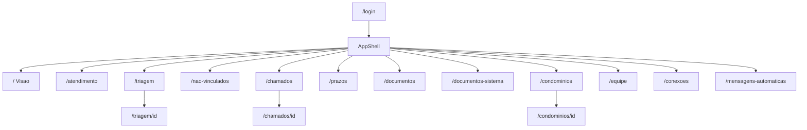

# Juricon — Wireframe de telas (auditoria UX/UI)

| Item | Valor |
|------|--------|
| Versão do sistema | 0.9.8 — Card fila Não vinculados |
| Data deste catálogo | 22/09/2026 |
| Escopo | Pasta `PORTAL JURIDICO CONDOMINIAL` (app operacional) |
| Natureza | **As-is** do código — não é redesign nem fonte de regras |
| Fonte de comportamento | [`DOCUMENTACAO-SISTEMA.md`](../DOCUMENTACAO-SISTEMA.md) |
| Onde olhar tokens | [`app/globals.css`](../app/globals.css) |
| Onde olhar shell | [`components/layout/app-shell.tsx`](../components/layout/app-shell.tsx) |
| Onde olhar botões | [`components/ui/button.tsx`](../components/ui/button.tsx) |

**Como usar este arquivo:** auditar ícones, margens, divisores, hierarquia e CTAs. Cada ficha tem checklist em branco. Correções visuais são outra entrega.

**Fora do escopo:** protótipo da pasta pai (`condominio-advogada/app`), questionário `perguntas/`, rota `/sindico`, rota `/ia`.

---

## Índice

1. [Sistema visual](#1-sistema-visual)
2. [0. Chrome — AppShell](#2-0-chrome--appshell)
3. [1. Login `/login`](#3-1-login-login)
4. [2. Visão `/`](#4-2-visão-)
5. [3. Inbox `/atendimento`](#5-3-inbox-atendimento)
6. [4. Triagem `/triagem`](#6-4-triagem-triagem)
7. [5. Triagem deep link `/triagem/[id]`](#7-5-triagem-deep-link-triagemid)
8. [6. Não vinculados `/nao-vinculados`](#8-6-não-vinculados-nao-vinculados)
9. [7. Chamados `/chamados`](#9-7-chamados-chamados)
10. [8. Ficha do chamado `/chamados/[id]`](#10-8-ficha-do-chamado-chamadosid)
11. [9. Documentos `/documentos`](#11-9-documentos-documentos)
11b. [9b. Documentos do sistema `/documentos-sistema`](#11b-9b-documentos-do-sistema-documentos-sistema)
12. [10. Condomínios `/condominios`](#12-10-condomínios-condominios)
13. [11. Ficha do condomínio `/condominios/[id]`](#13-11-ficha-do-condomínio-condominiosid)
14. [12. Equipe `/equipe`](#14-12-equipe-equipe)
15. [13. Conexões `/conexoes`](#15-13-conexões-conexoes)
15b. [13b. Mensagens automáticas `/mensagens-automaticas`](#15b-13b-mensagens-automáticas-mensagens-automaticas)
16. [14. Prazos `/prazos`](#16-14-prazos-prazos)
17. [Overlays](#17-overlays)
18. [Apêndice A — Matriz de papéis](#18-apêndice-a--matriz-de-papéis)
19. [Apêndice B — Mapa Lucide](#19-apêndice-b--mapa-lucide)
20. [Apêndice C — Checklist global](#20-apêndice-c--checklist-global)



---

## 1. Sistema visual

### 1.1 Paleta (hex reais)

| Token | Hex | Uso |
|-------|-----|-----|
| `--page` / `--background` | `#f5f6f8` | Fundo da página |
| `--card` / `--sidebar` / `--popover` | `#ffffff` | Cards, sidebar, popovers |
| `--ink` / `--foreground` | `#0f172a` | Texto principal |
| `--muted` / `--muted-foreground` | `#64748b` | Texto secundário / meta |
| `--brand` / `--primary` | `#1b3a4b` | Marca, links, botão primário, item ativo |
| `--brand-soft` | `#2a4f63` | — |
| `--primary-foreground` | `#f7f5ef` | Texto sobre navy |
| `--secondary` / `--muted-bg` / `--surface-2` | `#eef0f4` | Superfície secundária, botão secondary |
| `--border` / `--sidebar-border` | `#e3e6ec` | Bordas / divisores |
| `--border-strong` / `--input` | `#cdd3dd` | Inputs, bordas fortes |
| `--accent` | `#b8a07a` | Dourado decorativo |
| `--ok` / `--success` | `#059669` | Sucesso / WA conectado |
| `--warn` / `--warning` | `#d97706` | Aviso |
| `--danger` / `--destructive` | `#dc2626` | Erro / destrutivo |
| `--channel-whatsapp` | `#128c7e` | Canal WhatsApp |
| `--ring` | `#1b3a4b` | Focus ring |

**Status de chamado**

| Status | Texto | Fundo |
|--------|-------|-------|
| aberto | `#2563eb` | `#eff6ff` |
| em_andamento | `#d97706` | `#fffbeb` |
| aguardando | `#475569` | `#f1f5f9` |
| resolvido | `#059669` | `#ecfdf5` |
| arquivado | `#64748b` | `#f1f5f9` |

**Prioridade**

| Nível | Cor barra / pill |
|-------|------------------|
| urgente | `#dc2626` |
| alta | `#ea580c` |
| media | `#475569` (pill: fundo slate-100, borda slate-200) |
| baixa | `#94a3b8` (pill: fundo branco, borda slate-200) |

### 1.2 Tipografia e densidade

| Item | Valor |
|------|--------|
| Corpo | Inter (`--font-inter`) |
| Wordmark | Fraunces (`.font-wordmark`) |
| Base | `html { font-size: 14px }` |
| Títulos de seção | `text-[10–11px] tracking-[0.14em] uppercase` muted |
| Radius base | `--radius: 8px` |
| Botão | `rounded-lg`, h-8 default |
| Content max | `--content-max: 1440px` |
| Motion | fast 150ms · normal 200ms |
| Sombras | `--shadow-sm` / `--shadow-md` / `--shadow-lg` (rgba 15,23,42) |

### 1.3 Variantes de botão

| Variant | Aparência | Quando |
|---------|-----------|--------|
| `default` / `primary` | navy `#1b3a4b` + texto `#f7f5ef`, hover `#2a4f63` | CTA principal |
| `secondary` | fundo `#eef0f4` + texto navy | ação secundária |
| `outline` | borda `--border`, fundo branco | contorno |
| `ghost` | transparente, hover muted | ações leves / Arquivar |
| `destructive` | fundo danger/10, texto `#dc2626` | aviso suave |
| `danger` | sólido `#dc2626` + branco | ConfirmDialog destrutivo |
| `link` | texto primary + underline | links estilo botão |

**Sizes:** `default` `h-[36px]` (a raiz é 14px, então `h-9` ficaria 31,5px) · `xs` h-6 · `sm` h-7 · `lg` h-9 · `icon` / `icon-sm` / `icon-xs` / `icon-lg`

**Ícones em botão:** SVG default `size-4` (16px); xs/sm 12–14px.

### 1.4 Espaçamento do shell

| Contexto | Classes / medida |
|----------|------------------|
| Sidebar | ~14rem (shadcn sidebar) |
| Header sticky | `h-12`, `px-3`, `gap-3`, `border-b` |
| Main operacional | `/` sem padding (faixa branca + canvas `#f5f6f8`). Demais full-bleed: `p-3 lg:p-4`. Cartão branco, borda `#e3e6ec`, raio 8px |
| Main padded | `px-5 py-5 md:px-6 md:py-6`, max 1440px |
| Bottom nav mobile | `fixed`, `grid-cols-4`, `border-t`, `pb-16` no main |
| Item lista ativo | `border-l-2` brand + `bg color-mix(brand 6%, white)` |
| Workspace Inbox | `280px / 1fr / 300px` (lg); com **Expandir**: `280px / 1fr / max(300px, min(640px, 100% − 600px))` |
| Workspace Unlinked | `280px / 1fr / 240px` (xl) |
| Workspace Triagem | `240–320px / 1fr` (lg) |

### 1.5 FilterChip

Ativo: `border-primary bg-primary text-primary-foreground` · pill `px-3 py-1.5 rounded-full`.

---

## 2. 0. Chrome — AppShell

**Arquivo:** `components/layout/app-shell.tsx`  
**Quem vê:** qualquer usuário autenticado (itens `admin: true` filtrados no menu).

### Desktop

```text
┌─ ~14rem ───────┬──────────────────────────────────────────────────┐
│ [Ticket] Juricon│ [☰ lg:hidden]  [🔍 Buscar…]          (ml-auto)  │
│ (Fraunces 15px) ├──────────────────────────────────────────────────┤
│                 │                                                  │
│ OPERAÇÃO        │  MAIN                                            │
│  ▸ Visão        │  p-3/p-4 (operação) OU px-5 py-5 (max 1440)     │
│  Atendimento    │                                                  │
│  Triagem * [n]  │                                                  │
│  Não vinc. *[n] │                                                  │
│  Chamados [n]   │                                                  │
│  Prazos [n]     │                                                  │
│  Documentos     │                                                  │
│  Docs. sistema  │                                                  │
│  Condomínios    │                                                  │
│ ADMINISTRAÇÃO * │                                                  │
│  Equipe         │                                                  │
│  Docs. sistema  │                                                  │
│  Conexões       │                                                  │
│  Mensagens auto.│                                                  │
│ ─────────────── │                                                  │
│ ● WA · status   │  (admin, link → /conexoes)                       │
│ v0.9.0          │                                                  │
│ [Avatar] Nome ▼ │  menu: e-mail + Sair (LogOut)                    │
└─────────────────┴──────────────────────────────────────────────────┘
* só admin   ativo: barra vertical brand 2px + bg brand 8% + aria-current
```

### Mobile

```text
┌────────────────────────────────────┐
│ ☰   (busca oculta)          ● WA   │  header h-12
├────────────────────────────────────┤
│ conteúdo (1 painel por vez)        │
│ pb-16                              │
├────────────────────────────────────┤
│ Início  Inbox  Triagem|+  Mais     │  admin: Triagem no 3º slot
│ Início  Inbox  Chamados  Mais      │  funcionário: Chamados no 3º
└────────────────────────────────────┘
+ sheet: Chamados, Documentos, Documentos do sistema, Condomínios, Prazos,
  (Triagem/Não vinc. se admin e não no bottom), Equipe, Conexões,
  Mensagens automáticas, Sair
Sidebar = Sheet offcanvas ao tocar ☰
```

### Botões / links do chrome

| Rótulo | Ícone Lucide | Variant / visual | Função |
|--------|--------------|------------------|--------|
| Juricon (logo) | Ticket (14px no tile navy) | SidebarMenuButton → Link `/` | Home |
| Visão | LayoutDashboard | nav Link `/` | Dashboard |
| Atendimento | Inbox | nav Link `/atendimento` | Inbox |
| Triagem | ListChecks | nav Link `/triagem` · badge se count>0 | Fila triagem (admin) |
| Não vinculados | UserRoundX | nav Link `/nao-vinculados` · badge | Fila identidade (admin) |
| Chamados | Ticket | nav Link `/chamados` · badge abertos | Quadro/Lista |
| Prazos | CalendarClock | nav Link `/prazos` · badge vencidos | Deadlines |
| Documentos | FolderOpen | nav Link `/documentos` | Lista operacional |
| Documentos do sistema | FolderOpen | nav Link `/documentos-sistema` | Pasta do escritório (Operação + Administração) |
| Condomínios | Building2 | nav Link `/condominios` | Cadastro |
| Equipe | Users | nav Link `/equipe` | Usuários (admin) |
| Conexões | Radio | nav Link `/conexoes` | WhatsApp (admin) |
| Mensagens automáticas | MessageSquare | nav Link `/mensagens-automaticas` | Automação (admin) |
| Buscar… | Search (14px) | Input h-8 muted/50 | Submit → `?q=` no módulo ativo |
| WhatsApp · {status} | dot 6px ok/warn/muted | Link texto xs | `/conexoes` (admin) |
| Sair | LogOut | DropdownMenuItem | POST `/api/auth/logout` → `/login` |
| Início / Inbox / Triagem|Chamados / Mais | LayoutDashboard / Inbox / ListChecks|Ticket / Plus 18px | bottom Link + Sheet | Mobile only |
| SidebarTrigger | PanelLeft (shadcn) | ghost icon | Abre Sheet sidebar |

**Busca contextual:** `/chamados` → chamados; `/documentos-sistema` → docs do sistema; `/documentos` → docs; `/triagem` → triagem; `/nao-vinculados` → não vinc.; `/condominios` → condomínios; `/equipe` → equipe; senão → `/atendimento`.

### Checklist auditoria — Chrome

- [ ] Ícones: tamanho/alinhamento consistente entre grupos
- [ ] Margens: gap entre grupos, padding header/footer
- [ ] Linhas: `border-b` header vs `border-t` footer — peso visual
- [ ] Contraste: item ativo brand vs muted labels uppercase
- [ ] Bottom nav: só 3 itens — descoberta de Triagem/Chamados no mobile

---

## 3. 1. Login `/login`

**Arquivo:** `app/login/page.tsx`  
**Papel:** público (sem shell).

```text
┌────────────────────────────────────────┐
│         (page #f5f6f8 full screen)     │
│                                        │
│     ┌──────────────────────────┐       │
│     │      Juricon (Fraunces)  │       │
│     │  Gestão jurídica interna │       │
│     │                          │       │
│     │  E-mail  [____________]  │       │
│     │  Senha   [________] [👁] │       │
│     │  (erro vermelho se falha)│       │
│     │  [      Entrar         ] │       │
│     │  Acesso restrito…        │       │
│     └──────────────────────────┘       │
│         Frame max-w-sm shadow-lg       │
└────────────────────────────────────────┘
```

| Rótulo | Ícone | Variant | Função |
|--------|-------|---------|--------|
| Mostrar/Ocultar senha | Eye / EyeOff | ghost icon-sm | Toggle `type` password/text |
| Entrar / Entrando… | — | default w-full | POST `/api/auth/login` → `/` |

**Campos:** E-mail (required) · Senha (required).

**Estados:** loading no botão · erro `text-destructive` · sem empty.

### Checklist auditoria — Login

- [ ] Ícone olho alinhado no input (`right-1`)
- [ ] Margem `space-y-4` / padding Frame
- [ ] Hierarquia wordmark vs descrição
- [ ] Contraste tip “Acesso restrito”

---

## 4. 2. Visão `/`

**Arquivo:** `app/(app)/page.tsx` + `metric-card.tsx` + `attention-strip.tsx` + `activity-row.tsx`  
**Faixa branca + canvas `#f5f6f8`.** Os quatro KPIs ficam sempre, inclusive com zero. Funcionário não recebe link em Triagem nem Não vinculados.

```text
┌──────────────────────────────────────────────────────────────┐
│ Visão geral                    [CONECTADO → WA] [Atualizar]  │
│ O que precisa de ação agora · {data}                         │
│ AGORA · FILA OPERACIONAL                                     │
│ ┌──────────┐ ┌──────────┐ ┌──────────┐ ┌──────────┐          │
│ │rótulo  ícone│ rótulo ícone│ rótulo ícone│ rótulo ícone│    │
│ │ 0        │ │ 0        │ │ 0        │ │ 0        │          │
│ │ selo  →  │ │ selo  →  │ │ selo  →  │ │ selo  →  │          │
│ └──────────┘ └──────────┘ └──────────┘ └──────────┘          │
│ ATENÇÃO (cartão faixa)     │ MINHA OPERAÇÃO (tabela)         │
│ número + rótulo + ação     │ protocolo contato status prio   │
│ ATIVIDADE  [hora] ícone evento                    Atendimento│
└──────────────────────────────────────────────────────────────┘
```

| Rótulo | Ícone | Visual | Função |
|--------|-------|--------|--------|
| Cartão (4) | UserRoundX, ListChecks, MessageSquare, Ticket | Branco, número 28px, selo, ação navy | Navega a fila. Zero permanece |
| WA status | dot 8px | Pill azul se conectado | Estado real da sessão |
| Atualizar | RefreshCw | Botão navy h-8 | Refaz `GET /api/dashboard` |
| Itens Atenção | — | Cartão com faixa esquerda (vermelho/âmbar/azul/cinza) | Só se count > 0 |
| Tabela | StatusBadge + PriorityIndicator | Cabeçalho `#eef0f4` | `/chamados/[id]` |
| ActivityRow | MessageSquare | Hora em selo + link Atendimento | `/atendimento` |

**Sem `<Button>` na Visão.** Sem rótulo “SLA”, sem “2 horas”, sem cobrança. Loading: 4 skeletons. Empty da tabela: “Nenhum chamado em aberto.” Atenção vazia: “Nada exige atenção agora.” Error: ErrorBanner + ForbiddenState 403.

### Checklist auditoria — Visão

- [ ] Quatro cartões visíveis com zero
- [ ] Atenção omitida quando todas as contagens são 0
- [ ] Tabela no desktop, lista no celular
- [ ] Dot WA vs texto uppercase

---

## 5. 3. Inbox `/atendimento`

**Arquivos:** `app/(app)/atendimento/page.tsx` · `thread-panel.tsx` · `workspace-shell.tsx`  
**Full-bleed · h = `100dvh - 3rem` · grid 280 / 1fr / 300 (abaixo de lg: restante / 200). Em lg+, **Expandir** leva o contexto a `max(300px, min(640px, 100% − 600px))` com transição; a thread fica com no mínimo 320px.**

```text
┌─ Atendimento ── [Todas] [Não lidas] [Triagem] ──────────────┐
├─ 280px ──────┬─ thread 1fr ──────────────┬─ 300px contexto ─┤
│ Buscar…      │ ← Conversas (mobile)      │ ‹ Expandir       │
│              │ Nome contato              │ contato + fone   │
│ ● Nome       │ condo · canal        DEV  │ Condomínio       │
│   preview    │                           │ Chamado #PROT    │
│ #PROT selo   │  [bolhas WhatsApp/nota]   │ [Atualizar chamado]│
│ (ativo: barra│                           │ Triagem          │
│  brand)      │                           │ Accordion info   │
│              │ Resposta | Nota interna   │                  │
│              │ [msg…] [Anexar] [Áudio]   │                  │
│              │              [Enviar]     │                  │
└──────────────┴───────────────────────────┴──────────────────┘
MOBILE: (lista | thread) à esquerda + contexto fixo à direita
```

| Rótulo | Ícone | Variant | Função |
|--------|-------|---------|--------|
| Todas / Não lidas / Triagem | — | FilterChip | Filtro lista |
| Item conversa | Avatar iniciais | button row | Seleciona + mobile thread |
| ← Conversas | — | link brand | Volta lista (mobile) |
| Analisar | — | Link brand | `/triagem/[id]` se triage |
| #{protocol} | — | Link brand | `/chamados/[id]` |
| Atualizar chamado | Pencil | outline xs | Abre Editar chamado (bloco Chamado) |
| Resposta | — | primary/secondary sm | mode `publica` |
| Nota interna | — | primary/secondary sm | mode `interna` |
| Anexar | — | secondary sm | Abre seletor jpeg/png/pdf/audio |
| × (reply bar) | — | texto muted | Limpa citação |
| Áudio / Parar áudio | — | secondary sm | MediaRecorder |
| Cancelar (gravação) | — | ghost sm | Cancela áudio |
| Enviar | — | default | POST messages (+ file/reply) |
| Responder (bolha) | — | link | Seta replyTo |
| Reenviar (failed) | — | link | POST `/api/messages/:id/approve` |

**Campos:** busca conversas · mensagem · Anexar (jpeg/png/pdf/audio).

**Estados:** Empty “Tudo limpo” · Skeleton · ErrorBanner · aviso “WhatsApp não está conectado” / “não pode mandar WhatsApp”.

### Checklist auditoria — Inbox

- [ ] Larguras 280/300 vs conteúdo truncado
- [ ] Composer: Anexar + Enviar visíveis, wrap gap-2
- [x] Bolhas no padrão WhatsApp: enviada verde, recebida branca, falha vermelho claro, fundo bege; nota interna âmbar
- [ ] FilterChip ativo vs hierarquia título
- [ ] Atualizar chamado no contexto, não no cabeçalho

---

## 6. 4. Triagem `/triagem`

**Arquivos:** `app/(app)/triagem/page.tsx` · `triage-analysis-panel.tsx`  
**Admin only · full-bleed · split 240–320 / 1fr.**

```text
┌─ Triagem · N aguardando classificação · [Buscar…] ──────────┐
├─ lista ──────────┬─ análise (thread + form 240px) ──────────┤
│ Nome             │ Contato / mensagens (bolhas, sem composer)│
│ preview msg      │ │ Análise                                 │
│ condo · quando   │ │ Contato (ro) Condo (ro)                 │
│ telefone         │ │ Categoria ▼ Prioridade ▼ Responsável ▼  │
│ (ativo brand)    │ │ [ Promover a chamado ]  default w-full  │
│                  │ │ [ Arquivar ]            ghost w-full    │
└──────────────────┴───────────────────────────────────────────┘
MOBILE: lista OU análise (← Solicitações)
```

| Rótulo | Ícone | Variant | Função |
|--------|-------|---------|--------|
| Item fila | — | button row | Select + `?id=` |
| ← Solicitações | — | link brand | Mobile back |
| Promover a chamado | — | default w-full | PATCH action promote → `/chamados` |
| Arquivar | — | ghost w-full | Abre ConfirmDialog |
| Confirm Arquivar | — | danger | PATCH action archive |
| Confirm Cancelar | — | secondary | Fecha dialog |

**Campos análise:** Categoria · Prioridade · Responsável (opcional). Promover exige contato+condo.

**Estados:** Forbidden 403 · Empty “Tudo limpo” / “Selecione…” · Skeleton · ErrorBanner.

### Checklist auditoria — Triagem

- [ ] CTA Promover vs Arquivar (hierarquia)
- [ ] Thread sem composer — clareza de que resposta é na Inbox
- [ ] Densidade lista py-2.5

---

## 7. 5. Triagem deep link `/triagem/[id]`

**Arquivo:** `app/(app)/triagem/[id]/page.tsx`

```text
┌─ ← Triagem ─────────────────────────────────────────────────┐
│ Analisar solicitação                                        │
├─────────────────────────────────────────────────────────────┤
│ (mesmo TriageAnalysisPanel: thread + Análise)               │
└─────────────────────────────────────────────────────────────┘
```

| Rótulo | Ícone | Visual | Função |
|--------|-------|--------|--------|
| ← Triagem | — | Link brand | `/triagem` |
| (+ painel triagem) | — | — | Ver §4 |

**Estados:** 403 · 404 Empty · Skeleton · ErrorBanner.

### Checklist auditoria — Triagem/[id]

- [ ] Consistência header vs lista `/triagem`
- [ ] Back link vs título

---

## 8. 6. Não vinculados `/nao-vinculados`

**Arquivos:** `nao-vinculados/page.tsx` · `unlinked-queue.tsx` · `unlinked-identity-panel.tsx` · `thread-panel.tsx`  
**Admin only · grid fila 280 / conversa / Identidade 240 (abaixo de lg: restante / 200).**

```text
┌─ Não vinculados · N fora do fluxo… ─────────────────────────┐
├─ fila 280 ──────┬─ thread ───────────────┬─ Identidade 240 ─┤
│ Buscar…         │ (composer igual Inbox) │ 1.Msg 2.Identificar│
│ ┌─ card ───┐    │                        │ 3.Vincular→triagem │
│ │█ [av]Nome│    │                        │ Contato / Origem   │
│ │  tel·condo│   │                        │ Condo              │
│ │  preview │    │                        │ [Vincular ao fluxo]│
│ │  WhatsApp│    │                        │                    │
│ └──────────┘    │                        │                    │
└─────────────────┴────────────────────────┴────────────────────┘
DRAWER: Vincular ao fluxo (form enroll)
Telefone*  [+55 …]  [Puxar do WhatsApp | Conectar WhatsApp]
```

**Card da fila** = mesmo chrome de Atendimento (`rounded` + `border` + `border-l-2` primary quando selecionado). Hierarquia: nome/idade → telefone → preview → origem WhatsApp/DEV (sem protocolo).
| Rótulo | Ícone | Variant | Função |
|--------|-------|---------|--------|
| Item fila | — | select | Abre thread (coluna da esquerda no mobile; identidade permanece à direita) |
| Vincular ao fluxo (painel) | — | default w-full | Abre Drawer |
| Vincular ao fluxo (drawer) | — | default submit | POST enroll → `/triagem/[id]` |
| Puxar do WhatsApp | — | secondary | POST enrich-peer deep; só se PN livre e WA `open` |
| Conectar WhatsApp | — | secondary | → `/conexoes` se WA ≠ `open` e sem PN |
| (+ ThreadPanel) | — | — | Ver Inbox; sem botão Contexto nesta página |

**Campos drawer:** Já cadastrado (Select) · Nome* · Telefone* (se sem E.164; **Puxar do WhatsApp** se sessão `open`, senão **Conectar WhatsApp**) · Papel radio (Síndico/Administrador/Outro) · Cargo livre · E-mail · Condomínio*.

**Estados:** 403 · ErrorBanner · loading “Carregando fila…” · enrich “Puxando…” / “Consultando Evolution…” · toast se Evolution não liberar PN.

### Checklist auditoria — Não vinculados

- [ ] CTA único “Vincular ao fluxo” repetido painel/drawer
- [ ] Stepper texto 1-2-3 vs espaço
- [ ] Card da fila = mesmo chrome de Atendimento (borda/raio/barra)
- [ ] Fila 280px densidade hora/preview

---

## 9. 7. Chamados `/chamados`

**Arquivos:** `chamados/page.tsx` · `kanban-board.tsx` · `ticket-card.tsx`  
**Full-bleed · `px-4 pt-3 pb-3` · h viewport.**

```text
┌─ Chamados · N no quadro · [Novo chamado] (admin) ───────────┐
│ [Categoria▼] [Prioridade▼] [Responsável▼]  (+ busca mobile) │
│ [Aberto n][Em andamento][Aguardando][Resolvido] (mobile)    │
├──────────┬──────────┬──────────┬──────────┐                 │
│ Aberto   │ Andamento│ Aguardando│ Resolvido│                 │
│ ┌──────┐ │          │           │          │                 │
│ │█ #PRT│ │  card: faixa prioridade 0.5 left│                 │
│ │ título│ │  GripVertical + ⋯ MoreHorizontal│                │
│ │ condo │ │  menu: Mover para… / Abrir ficha│                │
│ └──────┘ │          │           │          │                 │
└──────────┴──────────┴──────────┴──────────┘                 │
DRAWER: Novo chamado (título, condo, contato, responsável)
```

| Rótulo | Ícone | Variant | Função |
|--------|-------|---------|--------|
| Novo chamado | — | default | Abre Drawer (admin) |
| Criar | — | default submit | POST `/api/tickets` |
| Criar chamado (empty) | — | outline sm (EmptyState) | Abre Drawer |
| Clique no card | — | button | `/chamados/[id]` |
| ⋯ Ações | MoreHorizontal 14px | DropdownTrigger | Menu |
| GripVertical | GripVertical 14px | handle DnD | Arrastar (desktop) |
| Mover para {status} | — | DropdownItem | PATCH status |
| Abrir ficha | — | DropdownItem | Navega ficha |
| FilterChip status | — | pill | Coluna mobile |

**Campos drawer:** Título* · Condomínio* · Contato* · Responsável (opcional).  
**Toolbar:** Categoria · Prioridade · Responsável/Sem responsável (admin).

### Checklist auditoria — Chamados

- [ ] Faixa prioridade 2px vs borda card
- [ ] Opacity menu só no hover desktop
- [ ] Empty vs 4 colunas vazias
- [ ] Truncate título line-clamp-1

---

## 10. 8. Ficha do chamado `/chamados/[id]`

**Arquivos:** `app/(app)/chamados/[id]/page.tsx` + `ticket-dossie-header` / `ticket-case-panel` / `ticket-edit-drawer` / `ticket-context-rail`  
**Full-bleed · dossiê `1fr / 280px` (lg+).**

```text
┌─ ← Chamados                                    [Detalhes*] [Editar dados] ─┐
│ #PROT  [StatusBadge]  [Priority]                                           │
│ título                                                                     │
│ condo · contato · responsável · prazo …                                    │
├─ [Caso|Linha do tempo|Docs n|Comunicação] ─┬─ Contexto 280px (lg+) ───────┤
│ Caso: categoria · aberto em                │ Condo / Contato / Resp        │
│ PRAZOS [Adicionar] · Concluir              │ Origem / Próximo prazo        │
│ (sem selects)                              │ *Detalhes = mesmo em Drawer   │
│ Linha do tempo: Timeline                   │                               │
│ Docs: lista Baixar (sem criar)             │                               │
│ Comunicação: bolhas + composer             │                               │
└────────────────────────────────────────────┴───────────────────────────────┘
DRAWER Editar: Título Prioridade Categoria Status Responsável(admin) [Salvar]
DIALOG: Adicionar prazo
```

| Rótulo | Ícone | Variant | Função |
|--------|-------|---------|--------|
| ← Chamados | — | Link brand | Volta kanban |
| Editar dados | — | secondary sm | Abre Drawer PATCH ticket |
| Detalhes | — | ghost sm | Só `<lg`: Drawer com contexto |
| Baixar | — | link primary | `/api/files/...` |
| Adicionar prazo | — | secondary sm | Dialog prazo |
| Concluir (prazo) | — | ghost sm | PATCH deadline done |
| Salvar (Drawer) | — | default | PATCH ticket |
| WhatsApp / Nota interna | — | primary/secondary sm | Toggle mode (`publica` / `interna`) |
| Enviar / Salvar nota | — | default | POST `/api/tickets/{id}/messages` |

**Estados:** 403 · 404 · Skeleton · ErrorBanner · docs/prazos empty quietos.

### Checklist auditoria — Ficha chamado

- [ ] Protocolo/status/prioridade uma vez no header
- [ ] Caso sem selects; edição só no Drawer com Labels
- [ ] Rail lg+ vs Detalhes Drawer mobile
- [ ] Dual composer (ficha vs Inbox) — consistência
- [ ] Labels uppercase 10px tracking
- [ ] Ações doc inline Baixar

---

## 11. 9. Documentos `/documentos`

**Arquivo:** `app/(app)/documentos/page.tsx`  
**Padded (não full-bleed).**

### Grade e pasta

```text
┌─ Documentos ───────────────────────────────────────────────┐
│ [Buscar condomínio…]                                       │
│ ┌ Card ──────────┐ ┌ Card ──────────┐                      │
│ │ Aurora  3 docs │ │ Sol    0 docs  │                      │
│ └────────────────┘ └────────────────┘                      │
└────────────────────────────────────────────────────────────┘
┌─ ← Condomínios · Aurora · [Novo documento] ────────────────┐
│ [Buscar título, finalidade…]                               │
│ documento | tipo | finalidade | data | Ver · Baixar        │
│                                          ┌─ ficha ────────┐ │
│                                          │ tipo · propósito│ │
│                                          │ Baixar          │ │
│                                          └────────────────┘ │
└────────────────────────────────────────────────────────────┘
DIALOG: Novo documento | DRAWER (celular): mesma ficha
```

Sem selo ICP, páginas ou hash. Campos só os que a API devolve.

| Rótulo | Ícone | Variant | Função |
|--------|-------|---------|--------|
| Novo documento | — | default | Dialog ficha (só na pasta) |
| Card / Linha | FileText / Image / Music | button | Abre pasta ou ficha |
| Baixar | — | link primary | Download |
| Cancelar (ficha) | — | secondary | Fecha Dialog |
| Salvar documento / Salvando… | — | default | Upload ficha (kind*, title*, purpose*, file*, condominiumId*) |

**Estados:** Empty grade / empty pasta · Skeleton · ErrorBanner.

### Checklist auditoria — Documentos

- [ ] Lista densa `divide-y` vs padded page
- [ ] Ícones pasta/arquivo size-4 muted
- [ ] Preview drawer vs dialog ficha

---

## 11b. 9b. Documentos do sistema `/documentos-sistema`

**Arquivo:** `app/(app)/documentos-sistema/page.tsx`  
**Padded.**

```text
┌─ Documentos do sistema · [Nova categoria]* ────────────────┐
│ [Buscar categoria…]                                        │
│ ┌ Card Regras ──┐ ┌ Card Avisos ─┐                         │
│ │ 3 documentos  │ │ 0 documentos │                         │
└────────────────────────────────────────────────────────────┘
┌─ ← Categorias · Regras · [Novo documento]* ────────────────┐
│ documento | quando usar | data | Ver · Baixar              │
│                              ┌─ ficha (4 textos + Baixar)─┐ │
└────────────────────────────────────────────────────────────┘
```

Só admin: Nova categoria, Excluir vazia, Novo documento. Sem chat de LLM nesta tela; arquivo indexado entra na análise do atendimento como regra geral.

### Checklist auditoria — Documentos do sistema

- [ ] Item ativo `/documentos` não marca esta rota
- [ ] Staff sem botões de mutação

---

## 12. 10. Condomínios `/condominios`

**Arquivo:** `app/(app)/condominios/page.tsx` · padded · master-detail.

```text
┌─ Condomínios · [Novo condomínio] (admin) ───────────────────┐
│ [Buscar…]                                                   │
├─ lista ──────┬─ detalhe (bg-background) ────────────────────┤
│ Nome         │ ┌ card ficha · Editar cadastro ────────────┐ │
│ (ativo brand)│ │ contagens Contatos / Documentos / Chamados│ │
│              │ └───────────────────────────────────────────┘ │
│              │ CONTATOS · [Adicionar contato] secondary     │
│              │ ┌ card contato (avatar · nome · tel) ───────┐ │
│              │ └───────────────────────────────────────────┘ │
│              │ CHAMADOS · ┌ card link /chamados/[id] ──────┐ │
│              │            └────────────────────────────────┘ │
└──────────────┴──────────────────────────────────────────────┘
DRAWERS: Novo condomínio | Novo contato
```

| Rótulo | Ícone | Variant | Função |
|--------|-------|---------|--------|
| Novo condomínio | — | default | Drawer create |
| Salvar (condo) | — | default submit | POST condominiums |
| Editar cadastro | — | link primary | `/condominios/[id]` |
| Adicionar contato | — | secondary | Drawer contato |
| Salvar contato | — | default submit | POST contact |
| Item lista | — | button | Seleciona detalhe |

**Empty:** “Tudo limpo”. Admin cria; funcionário leitura filtrada.

### Checklist auditoria — Condomínios

- [ ] Master-detail border-l ativo
- [ ] CTA Novo vs Adicionar contato (hierarquia)
- [ ] Painel direito cinza; ficha / contato / chamado em cards

---

## 13. 11. Ficha do condomínio `/condominios/[id]`

**Arquivo:** `app/(app)/condominios/[id]/page.tsx`

```text
┌─ ← Condomínios ─────────────────────┬─ Contatos 280px ──────┐
│ CADASTRO (grid 2 col)               │ [Adicionar] secondary │
│ Nome CNPJ Endereço Cidade/UF Obs    │ lista · Editar link   │
│ [Salvar cadastro] (admin)           ├───────────────────────┤
│ CHAMADOS #PROT →                    │ DOCUMENTOS · Baixar   │
│ COMUNICAÇÕES (histórico)            │ ▸ Histórico Accordion │
└─────────────────────────────────────┴───────────────────────┘
DRAWER: Novo / Editar contato
```

| Rótulo | Ícone | Variant | Função |
|--------|-------|---------|--------|
| ← Condomínios | — | Link brand | Lista |
| Salvar cadastro | — | default | PATCH (admin) |
| Adicionar contato | — | secondary sm | Drawer |
| Editar (contato) | — | link primary | Drawer edit |
| Salvar contato | — | default submit | POST/PATCH |
| #{protocol} | — | Link primary | `/chamados/[id]` |
| Baixar doc | — | link primary | arquivo |

**Campos cadastro:** Nome, CNPJ, Endereço, Cidade/UF, Observação (disabled se não admin).

### Checklist auditoria — Ficha condo

- [ ] Campos disabled vs botão Salvar
- [ ] Agrupamento Contatos / Chamados / Docs

---

## 14. 12. Equipe `/equipe`

**Arquivo:** `app/(app)/equipe/page.tsx` · **admin only** · padded.

```text
┌─ Equipe · N pessoas · [Novo usuário] ───────────────────────┐
│ [Buscar…] [Todos/Ativos/Inativos ▼]                         │
│ Pessoa | Função | Acesso | Status | Chamados                │
│ Avatar Nome/email | Badge | rascunho/enviar | Ativo | N     │
└─────────────────────────────────────────────────────────────┘
```

| Rótulo | Ícone | Variant | Função |
|--------|-------|---------|--------|
| Novo usuário | — | default | Drawer create |
| Criar | — | default submit | POST team |
| Linha usuário | Avatar | button | Abre edit |
| Salvar | — | default | PATCH |
| Redefinir senha | — | secondary | PATCH resetPassword → dialog |
| Desativar / Reativar | — | ghost | ConfirmDialog |
| Ok, já copiei | — | secondary | Fecha senha once |
| Confirm Desativar | — | danger | PATCH ativo=false |

**Campos:** Nome · Email · Perfil · checkbox “Não pode mandar WhatsApp”.  
**Badges:** Perfil admin=`dev` / func=`muted` · Status ok/muted.

### Checklist auditoria — Equipe

- [ ] Tabela densidade vs DataTable
- [ ] Três botões no drawer edit (Salvar / Reset / Desativar)
- [ ] Dialog senha mono break-all

---

## 15. 13. Conexões `/conexoes`

**Arquivos:** `conexoes/page.tsx` · `whatsapp-session-card.tsx` · **admin only**.

```text
┌─ Conexões · Canais utilizados pelo escritório ──────────────┐
│ ┌─ WhatsApp Web ─────────────────────────┐                  │
│ │ ● CONECTADO / Desconectado             │                  │
│ │ [Conectar WhatsApp] ou [Desconectar]   │                  │
│ └────────────────────────────────────────┘                  │
│ ▸ Desenvolvimento (Accordion)                               │
│   Mock / Cloud / extras · Adicionar conexão · Injetar mock  │
└─────────────────────────────────────────────────────────────┘
DIALOG QR · CONFIRM Desconectar
```

```text
┌──────────── Conectar WhatsApp ────────────┐
│ Escaneie o QR Code                        │
│ ┌──────────────────────────────────────┐  │
│ │              [QR 208px]              │  │
│ └──────────────────────────────────────┘  │
│ O código atualiza sozinho a cada ~20s.    │
│ Se o WhatsApp recusar, espere mudar       │
│ ou toque em Atualizar QR.                 │
│ WhatsApp → Aparelhos conectados → Escanear│
│ [Atualizar QR]              [Cancelar]    │
└───────────────────────────────────────────┘
```

| Rótulo | Ícone | Variant | Função |
|--------|-------|---------|--------|
| Conectar WhatsApp / Gerando QR… | — | default | Abre dialog + GET /qr; poll status 3s; poll QR fresh 15s |
| Atualizar QR / Tentar de novo | — | default | GET /qr?fresh=1 (ignora cache) |
| Desconectar / Desconectando… | — | secondary | Confirm → POST disconnect |
| Cancelar (QR) | — | secondary | Fecha dialog |
| Confirm Desconectar | — | danger | Confirma |
| Adicionar (dev) | — | default submit | POST connections |
| Injetar (dev) | — | default submit | POST mock-inbound |

**Campos DEV:** Nome conexão · Tipo · Telefone · Mensagem.

**Estados:** 403 · Empty “Nenhum WhatsApp…” · ErrorBanner env · Skeleton · QR gerando · QR visível · 503 Evolution · expirado 60s.

### Checklist auditoria — Conexões

- [ ] Status uppercase CONECTADO vs dot
- [ ] Accordion DEV vs card principal
- [ ] QR 208px (h-52) vs dialog padding
- [ ] Botão Atualizar QR visível com imagem
- [ ] Copy de atualização automática ~20s

---

## 15b. 13b. Mensagens automáticas `/mensagens-automaticas`

**Arquivos:** `mensagens-automaticas/page.tsx` · `[id]/page.tsx` · **admin only**.

```text
┌─ Mensagens automáticas ─────────────────────────────────────┐
│ [Alert warning] WhatsApp desconectado                       │
│ ┌ card ────────────────────────────────── [Inativa|Ativa] ┐ │
│ │ nome                                                    │ │
│ │ Primeiro contato recebido de cada cliente já cadastrado│ │
│ │ MENSAGEM (line-clamp 4)                                 │ │
│ │ Horário · Condições                                     │ │
│ │ Última execução              [Editar configuração]      │ │
│ └─────────────────────────────────────────────────────────┘ │
│ EXECUÇÕES RECENTES                                          │
│ [Hoje][Regra][Status][Contato]                              │
│ DataTable: Horário | Contato | Automação | Status           │
└─────────────────────────────────────────────────────────────┘
CONFIRM Ativar automação?  (só na primeira vez que fica Ativa)
```

```text
┌─ ← Mensagens automáticas · Configurar automação ────────────┐
│ Nome · Gatilho (só leitura) · Mensagem                      │
│ [{{nome}}] [{{condominio}}] [{{protocolo}}]                 │
│ Horário [time] até [time]                                   │
│ checkbox Não enviar quando houver atendimento ativo         │
│ Status [Inativa|Ativa]                                      │
│ Pré-visualização                                            │
│ [Cancelar] [Salvar automação]                               │
└─────────────────────────────────────────────────────────────┘
```

| Rótulo | Ícone | Variant | Função |
|--------|-------|---------|--------|
| Inativa / Ativa | — | secondary / primary | PATCH ativo; confirma na primeira ativação |
| Editar configuração | — | secondary | Link editor |
| Salvar automação | — | default submit | PATCH |
| Cancelar | — | secondary | Link lista |
| Ativar automação | — | primary (ConfirmDialog) | Confirma a primeira ativação |

**Estados:** 403 · skeleton · empty “Nenhuma automação” · alerta warning · variável inválida em danger · horário inválido.

### Checklist auditoria — Mensagens automáticas

- [ ] Alerta warning não cobre o card
- [ ] Botão Ativa/Inativa largura cheia no celular
- [ ] Pré-visualização não usa dado real do escritório

---

## 16. 14. Prazos `/prazos`

**Arquivo:** `app/(app)/prazos/page.tsx` · full-bleed · GET `/api/deadlines`.

```text
┌─ Prazos · datas internas do chamado ── [Todos][Hoje][Próximos][Atrasados] ─┐
│ vencimento | título                                                       │
│            | #protocolo · chamado                    [Concluir]           │
└───────────────────────────────────────────────────────────────────────────┘
```

Empty: “Nenhum prazo neste filtro”. Não é prazo processual oficial.

### Checklist auditoria — Prazos

- [ ] Chips vs FilterChip
- [ ] Overdue em danger
- [ ] Link para ficha do chamado

---

## 17. Overlays

### 17.1 Drawers (Sheet direita)

| Overlay | Tela | Título | Submit |
|---------|------|--------|--------|
| Novo chamado | `/chamados` | Novo chamado | Criar |
| Editar chamado | `/atendimento`, `/chamados/[id]` | Editar chamado | Salvar (fitContent + barra) |
| Novo condomínio | `/condominios` | Novo condomínio | Salvar |
| Novo contato | `/condominios`, `/[id]` | Novo contato | Salvar |
| Editar contato | `/condominios/[id]` | Editar contato | Salvar |
| Vincular ao fluxo | `/nao-vinculados` | Vincular ao fluxo | Vincular ao fluxo |
| Novo usuário | `/equipe` | Novo usuário | Criar (fitContent + barra) |
| Editar usuário | `/equipe` | Usuário | Salvar / Reset / Desativar destructive (fitContent + barra) |
| Preview documento | `/documentos` | título do doc | Baixar |

### 17.2 Dialogs (centro)

| Overlay | Tela | Título | Ações |
|---------|------|--------|-------|
| Ficha documento | `/documentos` | Novo documento | Cancelar secondary · Salvar documento default |
| QR WhatsApp | `/conexoes` | Conectar WhatsApp | Cancelar secondary |
| Senha provisória | `/equipe` | Senha provisória | Ok, já copiei secondary |

### 17.3 ConfirmDialog

| Overlay | Tela | Confirm | Variant |
|---------|------|---------|---------|
| Arquivar solicitação | Triagem | Arquivar | danger |
| Desconectar WhatsApp | Conexões | Desconectar | danger |
| Ativar automação? | Mensagens automáticas | Ativar automação | primary |
| Desativar usuário | Equipe | Desativar | danger |
| Confirmar vínculo | Não vinculados | Confirmar vínculo | primary |

**Padrão ConfirmDialog:** Cancelar = secondary · Confirm = danger ou primary.

### Checklist auditoria — Overlays

- [ ] Largura drawer consistente
- [ ] Título drawer vs PageHeader
- [ ] Espaço entre campos `space-y-3`
- [ ] Confirm danger vs ghost que abre

---

## 18. Apêndice A — Matriz de papéis

| Tela | admin | funcionario |
|------|-------|-------------|
| `/login` | ✓ | ✓ |
| `/` Visão | KPIs operacionais | KPIs “Meus chamados” |
| `/atendimento` | todas no fluxo | só dos seus chamados |
| `/triagem` | ✓ | 403 · oculto menu |
| `/nao-vinculados` | ✓ | 403 · oculto |
| `/chamados` | todos + Novo | só atribuídos · sem Novo |
| `/chamados/[id]` | ✓ | se assignedTo = eu |
| `/prazos` | todos visíveis | só dos seus chamados |
| `/documentos` | todos condomínios | condomínios com ticket seu |
| `/documentos-sistema` | GET + mutação | GET + Baixar; POST 403 |
| `/condominios` | CRUD | leitura filtrada |
| `/condominios/[id]` | PATCH | leitura |
| `/equipe` | ✓ | 403 |
| `/conexoes` | ✓ | 403 |
| `/mensagens-automaticas` | ✓ | 403 · oculto |

Síndico: **sem login** neste sistema.

---

## 19. Apêndice B — Mapa Lucide

| Ícone | Onde | Size típico |
|-------|------|-------------|
| Ticket | Logo shell + nav Chamados | 14px tile / default nav |
| LayoutDashboard | Visão / Início mobile | nav / 18px bottom |
| Inbox | Inbox / bottom | nav / 18px |
| ListChecks | Triagem | nav |
| UserRoundX | Não vinculados | nav |
| CalendarClock | Prazos | nav |
| FolderOpen | Documentos | nav / 16px |
| Building2 | Condomínios | nav |
| Users | Equipe | nav |
| Radio | Conexões | nav |
| MessageSquare | Mensagens automáticas | nav |
| Search | Header busca | 14px (`size-3.5`) |
| LogOut | Sair | menu |
| Eye / EyeOff | Login senha | icon-sm |
| GripVertical | Kanban drag | 14px |
| MoreHorizontal | Kanban menu | 14px |
| FileText / Image / Music | Lista docs | 16px |
| Plus | Mais (bottom) | 18px |

**Regra Button:** `[&_svg:not([class*='size-'])]:size-4`.

---

## 20. Apêndice C — Checklist global

Use ao auditar o produto inteiro (além dos checklists por tela).

### Ícones
- [ ] Uma família Lucide — sem misturar stroke weights
- [ ] Nav: todos o mesmo optical size
- [ ] Botões icon-only ≥ 40×40 hit area
- [ ] Empty states: ícone presente? consistente?

### Margens / ritmo
- [ ] Base 4/8px: evitar `py-2.5` + `py-3` aleatório na mesma família
- [ ] Full-bleed vs padded: transição ao mudar de rota
- [ ] PageHeader dense (`mb-3`) vs padrão (`mb-4`)
- [ ] Composer `p-3` alinhado entre Inbox / Não vinc. / Ficha

### Linhas / divisores
- [ ] `border-border` `#e3e6ec` — não “gritar” no squint test
- [ ] `divide-y` listas vs `border-b` seções
- [ ] Workspace `divide-x` — peso vs conteúdo
- [ ] Kanban card `border-border/80` vs faixa prioridade

### Hierarquia / cor
- [ ] Um accent de ação (brand) — links `→` vs botões
- [ ] Status/prioridade semânticos — não decorativos
- [ ] Texto 4 níveis: ink / muted / uppercase section / disabled
- [ ] FilterChip ativo navy vs chips inativos

### Estados
- [ ] Toda lista: DEFAULT · LOADING · EMPTY · ERROR · (403 se admin-only)
- [ ] Botão disabled opacity-50 + motivo (hint)
- [ ] Mobile pane: back link brand presente

### Mobile
- [ ] Bottom nav vs rotas admin (descoberta)
- [ ] Kanban chips vs 4 colunas
- [ ] Workspace 1 coluna por vez — labels ← claros

---

## Referência rápida de arquivos

| Rota | page.tsx | Componentes-chave |
|------|----------|-------------------|
| `/login` | `app/login/page.tsx` | Frame (reui) |
| `/` | `app/(app)/page.tsx` | AttentionStrip, ActivityRow |
| `/atendimento` | `app/(app)/atendimento/page.tsx` | ThreadPanel, WorkspaceShell |
| `/triagem` | `app/(app)/triagem/page.tsx` | TriageAnalysisPanel |
| `/triagem/[id]` | `app/(app)/triagem/[id]/page.tsx` | TriageAnalysisPanel |
| `/nao-vinculados` | `app/(app)/nao-vinculados/page.tsx` | UnlinkedQueue, UnlinkedIdentityPanel |
| `/chamados` | `app/(app)/chamados/page.tsx` | KanbanBoard, TicketCard |
| `/chamados/[id]` | `app/(app)/chamados/[id]/page.tsx` | Timeline, DocumentFichaForm |
| `/documentos` | `app/(app)/documentos/page.tsx` | DocumentFichaForm |
| `/documentos-sistema` | `app/(app)/documentos-sistema/page.tsx` | SystemDocumentFichaForm |
| `/condominios` | `app/(app)/condominios/page.tsx` | — |
| `/condominios/[id]` | `app/(app)/condominios/[id]/page.tsx` | — |
| `/equipe` | `app/(app)/equipe/page.tsx` | DataTable |
| `/conexoes` | `app/(app)/conexoes/page.tsx` | WhatsappSessionCard |
| Shell | — | `components/layout/app-shell.tsx` |

---

*Fim do catálogo as-is v0.8.0. Atualizar este arquivo quando layout, tokens ou CTAs mudarem; regras de negócio continuam em DOCUMENTACAO-SISTEMA.md.*
