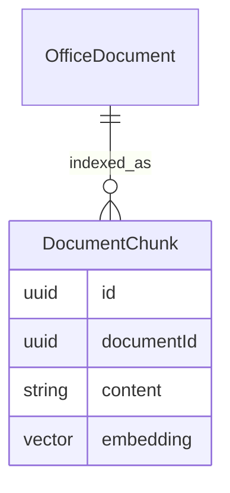

# IA futura (rascunho — não implementado)

Este arquivo registra intenção de arquitetura. **Não há LLM, embeddings, pgvector, RAG, DocumentChunk nem agents neste repositório.**

Operação atual: `OfficeDocument` guarda arquivo + `ingestStatus` (`stored` por padrão). `SystemDocument` guarda arquivo do escritório + `purpose`, `whenToUse` e `searchHints` (texto para RAG futuro). `DocumentIndexPort` em `lib/search/document-index-port.ts` é **no-op** (`queued: false`). Upload não cria vetor nem chama LLM.

Quando (e se) o contrato autorizar:

- A ingestão de mensagem cadastrada continua sendo `Conversation` + `TriageItem`. Número avulso não gera triagem. A IA **não** cria Ticket sozinha. Promoção a chamado é humana.
- Gatilho de índice = `DocumentIndexPort.enqueue` (hoje no-op). Job futuro lê `OfficeDocument` com `ingestStatus=pending_index` e/ou `SystemDocument.searchHints` / `whenToUse` como metadados de busca, sem implementar o job nesta entrega.
- Qualquer modelo deve ser chamado por um serviço com allowlist de tools, sem acesso direto ao Prisma com privilégio irrestrito.
- Dados de conversa são conteúdo do cliente; logs de produção não devem gravar o corpo completo.
- Vetores, se existirem, ficam em schema/tabela própria, nunca substituindo FKs de Contact/Condominium/Ticket.

## ER futuro (não migrado)

`DocumentChunk(documentId, content, embedding)` **não existe** no Prisma atual. Sem `CREATE EXTENSION vector` nesta entrega.
